# Feature 03 -- Spring Security Architecture & Filter Chain

> **Project:** Student Management API\
> **Feature branch:** `feature/spring-security-architecture`\
> **Application port:** `8081`\
> **Focus:** Understanding how Servlet filters, Spring Security filters,
> authentication, authorization, and request processing fit together.

------------------------------------------------------------------------

## Table of Contents

1.  [Feature Overview](#1-feature-overview)
2.  [Application Context and Starting
    Point](#2-application-context-and-starting-point)
3.  [The Servlet Filter Foundation](#3-the-servlet-filter-foundation)
4.  [Spring Security Enters the Servlet Filter
    Chain](#4-spring-security-enters-the-servlet-filter-chain)
5.  [The Four Similar-Sounding Filter
    Components](#5-the-four-similar-sounding-filter-components)
6.  [Configuring Spring Security with
    HttpSecurity](#6-configuring-spring-security-with-httpsecurity)
7.  [Authentication and
    Authorization](#7-authentication-and-authorization)
8.  [The Initial SecurityFilterChain and Its
    Filters](#8-the-initial-securityfilterchain-and-its-filters)
9.  [Initial Postman Experiments and Observed
    Logs](#9-initial-postman-experiments-and-observed-logs)

------------------------------------------------------------------------

## 1. Feature Overview

This feature studies the internal request-processing architecture of
Spring Security rather than treating security as a collection of
configuration methods.

The central questions are:

-   How does an HTTP request travel from Postman or a browser through
    Tomcat and into a Spring Boot application?
-   What is a Servlet filter, and how is it different from a Spring
    Security filter?
-   How does Spring Security connect its Spring-managed filters to the
    Servlet container?
-   What are `DelegatingFilterProxy`, `FilterChainProxy`,
    `SecurityFilterChain`, and `FilterChain`?
-   How does `HttpSecurity` build a `SecurityFilterChain`?
-   Where do authentication and authorization happen?
-   What do the filters visible in Spring Security debug output actually
    do?

The feature develops the architecture in stages:

1.  Start with the Servlet filter mechanism and the custom filters
    already present in the project.
2.  Introduce Spring Security's integration with the Servlet filter
    chain.
3.  Understand the proxy and chain components.
4.  Configure a `SecurityFilterChain` using `HttpSecurity`.
5.  Observe the security filters and request processing in the running
    application.
6.  Extend the model to multiple chains, SecurityContext persistence,
    and exception handling in the later sections of this README.

### The high-level request path

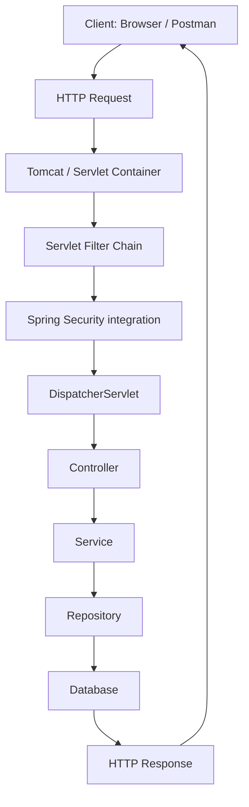

This is a high-level overview. The detailed placement and ordering of
the Servlet filters and Spring Security filters are explained below.

------------------------------------------------------------------------

## 2. Application Context and Starting Point

The work was performed in the existing **Student Management** Spring
Boot project. The project already had application-level Servlet filters,
so the goal was to understand how Spring Security fits into that
existing request pipeline.

The relevant application configuration included:

``` properties
spring.application.name=Student-management
server.port=8081

spring.datasource.url=jdbc:mysql://localhost:3306/student_management
spring.datasource.username=root
spring.datasource.password=${DB_PASSWORD}
spring.datasource.driver-class-name=com.mysql.cj.jdbc.Driver

spring.jpa.hibernate.ddl-auto=update
spring.jpa.show-sql=true
spring.jpa.properties.hibernate.format_sql=true

spring.security.debug=true
```

> **Credential handling:** Do not commit a real database password, Basic
> Authentication credential, session cookie, or other secret to a public
> repository. Use an environment variable or an ignored local
> configuration file for local credentials.

At the beginning of this feature:

-   The application was running on port `8081`.
-   The database was MySQL, using the `student_management` database.
-   The existing custom Servlet filters were retained.
-   `FilterConfiguration.java` was already part of the project.
-   The feature was developed on the
    `feature/spring-security-architecture` branch.
-   `spring.security.debug=true` was used during investigation to
    inspect Spring Security's filter configuration and processing.

The existing custom filters were important to the learning process
because they made it possible to compare the outer Servlet filter chain
with Spring Security's own internal filter chain.

------------------------------------------------------------------------

## 3. The Servlet Filter Foundation

### 3.1 What is a Servlet filter?

A Servlet filter is a Java component that can intercept an HTTP request
before it reaches the target Servlet and can also perform work while the
response travels back.

Servlet filters implement the Jakarta Servlet API's `Filter` interface:

``` java
import jakarta.servlet.Filter;

public class MyCustomFilter implements Filter {
    // Filter methods
}
```

A filter can perform work:

-   Before the request proceeds.
-   By deciding whether or how to continue the chain.
-   After downstream processing has completed and the response is
    returning.

The central method is:

``` java
public void doFilter(
        ServletRequest request,
        ServletResponse response,
        FilterChain chain
) throws IOException, ServletException {
    // Before downstream processing

    chain.doFilter(request, response);

    // After downstream processing
}
```

`chain.doFilter(request, response)` passes processing to the next filter
in the Servlet filter chain. If there are no more filters, processing
continues to the target Servlet, such as Spring MVC's
`DispatcherServlet`.

### 3.2 A simple before-and-after example

``` java
@Override
public void doFilter(
        ServletRequest request,
        ServletResponse response,
        FilterChain chain
) throws IOException, ServletException {

    System.out.println("Before request");

    chain.doFilter(request, response);

    System.out.println("After response");
}
```

The code before `chain.doFilter()` runs on the inward request journey.
The code after it runs when downstream processing returns.

This explains why filter log messages can appear in a different order
before and after the controller executes.

### 3.3 Creating a filter does not automatically register it

Defining a class that implements `Filter` does not, by itself, tell
Tomcat to execute that filter.

The Servlet container must know:

1.  Which filter object should be executed.
2.  Which URL patterns the filter applies to.
3.  The filter's position in the filter sequence.
4.  How to invoke its lifecycle methods.

This process is called **filter registration**.

A filter can be registered using Servlet mechanisms such as `@WebFilter`
together with Servlet component scanning, or through Spring Boot's
`FilterRegistrationBean`.

Example using `FilterRegistrationBean`:

``` java
@Bean
public FilterRegistrationBean<MyCustomFilter> myFilter() {

    FilterRegistrationBean<MyCustomFilter> registration =
            new FilterRegistrationBean<>();

    registration.setFilter(new MyCustomFilter());
    registration.addUrlPatterns("/students/*");

    return registration;
}
```

Spring Boot provides the registration bean, and the Servlet container
executes the registered filter.

### 3.4 URL mapping on a Servlet filter

For example:

``` java
@WebFilter(urlPatterns = "/students/*")
public class MyCustomFilter implements Filter {
    // ...
}
```

This is a Servlet filter URL mapping. It determines which requests pass
through this particular custom filter.

It does **not** specify whether those requests require authentication.
That is a separate Spring Security authorization decision.

The common path-pattern distinction is:

  -----------------------------------------------------------------------
  Pattern                             Practical meaning
  ----------------------------------- -----------------------------------
  `/students/*`                       One path segment beneath
                                      `/students`

  `/students/**`                      Nested paths beneath `/students`,
                                      including multiple path segments
  -----------------------------------------------------------------------

For example, `/students/1` matches both patterns, while
`/students/1/details` is matched by the recursive `/**` form rather than
the single-segment `/*` form. Exact matching behavior depends on the
matcher/API being used.

------------------------------------------------------------------------

## 4. Spring Security Enters the Servlet Filter Chain

Spring Security also uses Servlet filters. The important difference is
that its security filters are assembled and managed through Spring
Security's own infrastructure.

The Servlet container manages the outer Servlet filter chain. Spring
manages application beans. These two parts need a bridge.

That bridge is **`DelegatingFilterProxy`**.

### 4.1 What is DelegatingFilterProxy?

`DelegatingFilterProxy` is a Servlet `Filter` that acts as a bridge
between the Servlet container and a Spring-managed filter bean.

It does not normally implement the application's authentication or
authorization rules itself. Instead, it delegates request processing to
a filter bean managed by Spring.

The usual relationship in Spring Security is:

1.  Tomcat invokes the registered `DelegatingFilterProxy`.
2.  The proxy locates the Spring-managed bean named
    `springSecurityFilterChain`.
3.  That bean is a `FilterChainProxy`.
4.  `FilterChainProxy` selects the appropriate Spring Security chain.
5.  The selected security chain executes its configured security
    filters.

Spring Boot and Spring Security configure this integration automatically
in a normal Spring Boot security setup. Application code generally does
not need to instantiate `DelegatingFilterProxy` manually.

### 4.2 What does "registered with the Servlet container" mean?

It means Tomcat knows that the proxy is a Servlet filter and should
invoke it as part of the outer Servlet filter chain.

The proxy is therefore invoked by the Servlet container just like other
registered Servlet filters. The difference is that it delegates the work
to a Spring-managed object.

### 4.3 What does "Spring-managed" mean here?

Spring's `ApplicationContext` is the container that manages application
beans and their dependencies.

The `ApplicationContext` is not returned to Tomcat after the security
filters finish. It remains the Spring container. `DelegatingFilterProxy`
obtains the target Spring bean from that context and delegates
processing to it.

Conceptually:

``` text
Tomcat
  |
  v
DelegatingFilterProxy
  |
  | looks up Spring bean
  v
Spring ApplicationContext
  |
  v
Bean: springSecurityFilterChain
  |
  v
FilterChainProxy
```

------------------------------------------------------------------------

## 5. The Four Similar-Sounding Filter Components

These names are easy to confuse, but they refer to different things.

  -----------------------------------------------------------------------------
  Name                          What it is              Responsibility
  ----------------------------- ----------------------- -----------------------
  `FilterChain`                 Servlet API interface   Continues execution to
                                                        the next Servlet filter

  `SecurityFilterChain`         Spring Security         Represents a request
                                interface               matcher and the
                                                        security filters
                                                        associated with it

  `FilterChainProxy`            Spring Security class   Selects and executes
                                                        the appropriate Spring
                                                        Security chain

  `springSecurityFilterChain`   Spring bean name        Identifies the
                                                        Spring-managed
                                                        `FilterChainProxy` bean
  -----------------------------------------------------------------------------

### 5.1 FilterChain

The `FilterChain` passed into a Servlet filter's `doFilter()` method is
the Servlet API mechanism for continuing execution:

``` java
chain.doFilter(request, response);
```

It means: continue to the next filter in the outer Servlet filter chain.

### 5.2 SecurityFilterChain

A `SecurityFilterChain` represents a Spring Security chain. It
determines whether that chain applies to a request and provides the
security filters that belong to it.

It is not the same interface as the Servlet API's `FilterChain`.

### 5.3 FilterChainProxy

`FilterChainProxy` is a Spring Security class. It coordinates Spring
Security chains. It checks the configured `SecurityFilterChain`
instances and selects the first matching chain.

It does not mean that every configured security chain runs one after
another. The first matching chain is selected for a request.

### 5.4 springSecurityFilterChain

`springSecurityFilterChain` is the Spring bean name used by the proxy
integration. The object behind that bean is a `FilterChainProxy`.

The name is not another kind of filter chain or a separate interface.

### 5.5 Relationship between the components

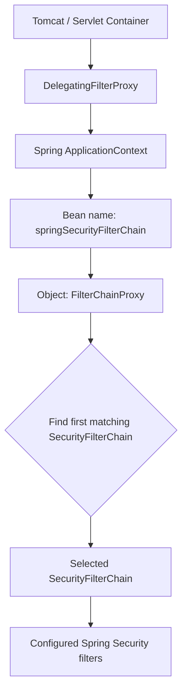

### 5.6 Why do we need SecurityFilterChain if Spring Security already provides built-in filters?

Spring Security supplies filter implementations, but the application
still needs to configure which security behavior applies to which
requests.

Examples of built-in filters include:

-   `SecurityContextHolderFilter`
-   `BasicAuthenticationFilter`
-   `AnonymousAuthenticationFilter`
-   `ExceptionTranslationFilter`
-   `AuthorizationFilter`

The developer generally does not need to reimplement these filters.
Instead, the developer configures Spring Security through
`HttpSecurity`, and Spring Security assembles the appropriate filters.

Custom filters are useful when an application has a requirement not
already handled by the built-in mechanisms, for example:

-   Request logging.
-   Measuring execution time.
-   Validating an application-specific token.
-   Application-specific request checks.
-   A custom authentication mechanism.

A custom filter should not be created merely to reproduce functionality
already provided by a built-in filter.

------------------------------------------------------------------------

## 6. Configuring Spring Security with HttpSecurity

### 6.1 The initial SecurityConfig

The first security configuration used in this feature was:

``` java
@Configuration
public class SecurityConfig {

    @Bean
    public SecurityFilterChain securityFilterChain(
            HttpSecurity http
    ) throws Exception {

        http
            .csrf(csrf -> csrf.disable())
            .authorizeHttpRequests(auth ->
                auth.anyRequest().authenticated()
            )
            .httpBasic(Customizer.withDefaults());

        return http.build();
    }
}
```

Required imports include:

``` java
import org.springframework.context.annotation.Bean;
import org.springframework.context.annotation.Configuration;
import org.springframework.security.config.Customizer;
import org.springframework.security.config.annotation.web.builders.HttpSecurity;
import org.springframework.security.web.SecurityFilterChain;
```

### 6.2 What each part does

  -----------------------------------------------------------------------
  Code                                Meaning
  ----------------------------------- -----------------------------------
  `@Configuration`                    Marks the class as a source of
                                      Spring bean definitions

  `@Bean`                             Registers the method's returned
                                      object as a Spring bean

  `SecurityFilterChain`               The configured Spring Security
                                      chain returned by the method

  `HttpSecurity http`                 Configuration/builder object
                                      supplied by Spring Security

  `csrf(...)`                         Configures Cross-Site Request
                                      Forgery protection

  `authorizeHttpRequests(...)`        Configures request authorization
                                      rules

  `anyRequest().authenticated()`      Requires authentication for every
                                      request handled by this chain

  `httpBasic(...)`                    Enables HTTP Basic authentication

  `http.build()`                      Builds and returns the configured
                                      `SecurityFilterChain`
  -----------------------------------------------------------------------

### 6.3 Who creates HttpSecurity?

Spring Security provides the `HttpSecurity` object through its
configuration infrastructure and injects it into the configuration
method.

The application does not need to define its own `@Bean` method to
instantiate `HttpSecurity`, and it should not try to construct it
manually.

``` java
@Bean
public SecurityFilterChain securityFilterChain(HttpSecurity http)
        throws Exception {
    // Configure the supplied HttpSecurity object
    return http.build();
}
```

The parameter is supplied when Spring invokes the bean method.

### 6.4 HttpSecurity and the Builder pattern

`HttpSecurity` is used as a builder. The chained configuration methods
configure the desired behavior, and `build()` creates the configured
result.

``` java
http
    .csrf(csrf -> csrf.disable())
    .authorizeHttpRequests(auth ->
        auth.anyRequest().authenticated()
    )
    .httpBasic(Customizer.withDefaults());

return http.build();
```

The returned object is a `SecurityFilterChain`.

The word "chain" describes the sequential execution of configured
filters. It does not require the chain to be implemented as a literal
linked list with `next` references.

Conceptually:

``` text
HttpSecurity
    |
    | configuration methods
    v
build()
    |
    v
SecurityFilterChain
    |
    +-- Request matcher
    |
    +-- Ordered security filters
```

### 6.5 Does custom SecurityConfig replace Spring Security's built-in filters?

No. The configuration tells Spring Security how to assemble and
configure its built-in filters.

For example:

-   `.httpBasic(Customizer.withDefaults())` configures HTTP Basic
    authentication and the filter needed to process Basic credentials.
-   `.authorizeHttpRequests(...)` configures the authorization behavior
    enforced by the security filters.

The developer is configuring the framework, not replacing its internal
filters.

------------------------------------------------------------------------

## 7. Authentication and Authorization

Authentication and authorization are related but different operations.

  Concept          Question it answers
  ---------------- ---------------------------------
  Authentication   Who are you?
  Authorization    What are you allowed to access?

### 7.1 Authentication

Authentication establishes the identity of the requester. With HTTP
Basic, the client supplies credentials in the HTTP `Authorization`
header.

### 7.2 Authorization

Authorization evaluates whether the authenticated identity is allowed to
perform the requested operation.

For example:

``` java
.authorizeHttpRequests(auth ->
    auth.anyRequest().authenticated()
)
```

This rule requires an authenticated user for every request handled by
the selected chain.

It does not mean that a particular controller method or URL pattern is
being selected by a custom Servlet filter. It is a Spring Security
authorization rule.

### 7.3 Why authentication comes before authorization

For a protected request, Spring Security needs an authenticated identity
before it can evaluate rules such as `authenticated()`, `hasRole(...)`,
or `hasAuthority(...)`.

The high-level order is:

1.  Select the applicable security chain.
2.  Process authentication credentials or recover an existing
    authentication.
3.  Evaluate authorization rules.
4.  Continue to the application if access is permitted.

The detailed lifecycle, anonymous authentication, and exception-handling
paths are documented in later sections.

------------------------------------------------------------------------

## 8. The Initial SecurityFilterChain and Its Filters

With the initial configuration and HTTP Basic enabled, Spring Security
debug output showed a chain similar to:

``` text
Security filter chain:
[
    DisableEncodeUrlFilter
    WebAsyncManagerIntegrationFilter
    SecurityContextHolderFilter
    HeaderWriterFilter
    LogoutFilter
    BasicAuthenticationFilter
    RequestCacheAwareFilter
    SecurityContextHolderAwareRequestFilter
    AnonymousAuthenticationFilter
    ExceptionTranslationFilter
    AuthorizationFilter
]
```

The exact filter list and ordering depend on the Spring Security version
and configuration. Treat the list above as the observed configuration
for this learning exercise, not as a universal fixed list.

### 8.1 Filters encountered in the initial output

  -------------------------------------------------------------------------------
  Filter                                      High-level responsibility
  ------------------------------------------- -----------------------------------
  `DisableEncodeUrlFilter`                    Prevents URL-based session ID
                                              rewriting in the relevant
                                              configuration

  `WebAsyncManagerIntegrationFilter`          Integrates the SecurityContext with
                                              Spring MVC asynchronous request
                                              processing

  `SecurityContextHolderFilter`               Loads the security context for
                                              request processing and clears the
                                              holder at the end

  `HeaderWriterFilter`                        Writes configured security-related
                                              HTTP response headers

  `LogoutFilter`                              Handles configured logout requests

  `BasicAuthenticationFilter`                 Processes HTTP Basic credentials

  `RequestCacheAwareFilter`                   Works with saved requests and
                                              request-cache behavior

  `SecurityContextHolderAwareRequestFilter`   Applies Servlet API request-wrapper
                                              integration with the security
                                              context

  `AnonymousAuthenticationFilter`             Supplies an anonymous
                                              authentication when no other
                                              authentication is present

  `ExceptionTranslationFilter`                Translates relevant downstream
                                              security exceptions into HTTP
                                              security responses

  `AuthorizationFilter`                       Enforces the configured request
                                              authorization rules
  -------------------------------------------------------------------------------

The later sections explain the SecurityContext lifecycle, authentication
processing, authorization, and exception translation in more detail.

### 8.2 Why do security filters appear separately from custom Servlet filters?

The Spring Security debug output lists the filters inside Spring
Security's selected security chain.

The application's custom Servlet filters are registered in the outer
Servlet filter chain. They are not automatically members of the
`SecurityFilterChain`.

Both are Servlet filters in the broader request-processing architecture,
but they are managed and configured through different mechanisms.

------------------------------------------------------------------------

## 9. Initial Postman Experiments and Observed Logs

### 9.1 Test without credentials

The initial rule was:

``` java
.authorizeHttpRequests(auth ->
    auth.anyRequest().authenticated()
)
```

A request such as:

``` http
GET http://localhost:8081/students
```

without authentication was rejected with:

``` http
HTTP/1.1 401 Unauthorized
```

This showed that the configured security chain required authentication
before the request could reach the protected application endpoint.

### 9.2 Test with HTTP Basic

The configuration enabled HTTP Basic:

``` java
.httpBasic(Customizer.withDefaults())
```

In Postman, selecting **Basic Auth** causes Postman to construct an HTTP
Authorization header from the supplied username and password.

The header has this form:

``` http
Authorization: Basic <base64-encoded-credentials>
```

The Base64 value represents the username and password joined with a
colon. Base64 is encoding, not encryption. HTTPS is necessary to protect
credentials in transit.

For the default Spring Boot user configuration used during the initial
experiment, the generated startup password was used with the default
username `user`.

With valid credentials, the request was authenticated and could proceed
when the authorization rule permitted it.

### 9.3 Custom Servlet filter output

The project already had two custom Servlet filters. Their logs showed
the nested before/after behavior:

``` text
Second Filter - Before
First Filter - Before Request received

Hibernate:
    select
        s1_0.id,
        s1_0.department,
        s1_0.name
    from
        studenttable s1_0

First Filter - After Response completed
Second Filter - After
```

The database query appeared between the inward and outward filter
messages because the controller and application layers ran after the
filters had passed the request onward.

### 9.4 Observed POST request

A successful POST request produced an insert similar to:

``` text
Hibernate:
    insert
    into
        studenttable
        (department, name)
    values
        (?, ?)
```

The observed custom-filter messages were:

``` text
Second Filter - Before
First Filter - Before Request received

Hibernate: insert into studenttable ...

First Filter - After Response completed
Second Filter - After
```

This demonstrated two separate ideas:

1.  Spring Security had its own configured security filter chain.
2.  The custom Servlet filters still ran as part of the application's
    outer Servlet filter chain.

### 9.5 Why the response-side messages appear in reverse order

Consider two filters:

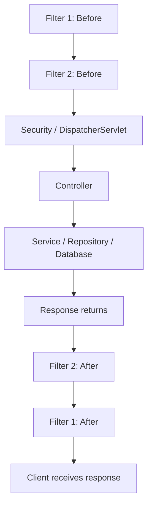

The request travels inward through the filters. After downstream
processing returns, execution resumes after each `chain.doFilter()` call
in reverse nesting order.

This is why the earlier console output showed the second filter's
"Before" message first and its "After" message last.

------------------------------------------------------------------------

**End of Batch 1**

The next batch continues this same README with:

-   Multiple `SecurityFilterChain` beans.
-   `securityMatcher()` and `@Order`.
-   First-match chain selection and fallback chains.
-   How authentication and authorization run inside the selected chain.
-   The distinction between HTTP Basic, JWT, and session-based
    authentication.
# Spring Security Architecture – Batch 2

> **Scope:** Multiple `SecurityFilterChain` beans, request matching, chain ordering, HTTP Basic, CSRF, and Spring Security debugging.
>
> **Continuation:** This is Batch 2 of the Spring Security architecture README. It is intentionally standalone so it can be pasted after Batch 1.

# 10. Multiple SecurityFilterChain Beans

The first configuration used one `SecurityFilterChain` for all requests. Spring Security also supports multiple chains, each intended for a different category of requests.

This is useful when different parts of an application need different security behavior.

For example:

- Student API endpoints may require HTTP Basic authentication.
- Other endpoints may be handled by a separate chain with different rules.
- A fallback chain can handle requests that do not match a more specific chain.

The important components are:

- `securityMatcher()` – determines whether a particular chain applies to a request.
- `@Order` – determines the priority in which chains are considered.
- `FilterChainProxy` – selects the first matching `SecurityFilterChain`.

## 10.1 What does securityMatcher() do?

Consider:

```java
.securityMatcher("/students/**")
```

This configures the request matcher for that `SecurityFilterChain`.

It means that the chain is intended to apply to requests matching paths under `/students`.

Examples:

| Request path | Matches `/students/**`? |
|---|---:|
| `/students` | Yes, depending on the matcher semantics in use |
| `/students/1` | Yes |
| `/students/security-info` | Yes |
| `/students/1/details` | Yes |
| `/products` | No |
| `/employees` | No |

The matcher determines whether the chain applies. It does not itself decide whether the user is authenticated or authorized.

## 10.2 What does @Order do?

When multiple `SecurityFilterChain` beans exist, Spring Security considers them according to their order.

A lower order value has higher priority:

```java
@Bean
@Order(1)
public SecurityFilterChain apiSecurityFilterChain(HttpSecurity http)
        throws Exception {
    // ...
    return http.build();
}

@Bean
@Order(2)
public SecurityFilterChain defaultSecurityFilterChain(HttpSecurity http)
        throws Exception {
    // ...
    return http.build();
}
```

The chain with `@Order(1)` is considered before the chain with `@Order(2)`.

`@Order` does not mean that both chains execute for the same request. `FilterChainProxy` selects the **first matching chain**.

## 10.3 Example: a specific API chain and a fallback chain

```java
@Configuration
public class SecurityConfig {

    @Bean
    @Order(1)
    public SecurityFilterChain apiSecurityFilterChain(
            HttpSecurity http) throws Exception {

        http
            .securityMatcher("/students/**")
            .csrf(csrf -> csrf.disable())
            .authorizeHttpRequests(auth ->
                auth.anyRequest().authenticated()
            )
            .httpBasic(Customizer.withDefaults());

        return http.build();
    }

    @Bean
    @Order(2)
    public SecurityFilterChain defaultSecurityFilterChain(
            HttpSecurity http) throws Exception {

        http
            .authorizeHttpRequests(auth ->
                auth.anyRequest().permitAll()
            );

        return http.build();
    }
}
```

### How does Spring Security choose?

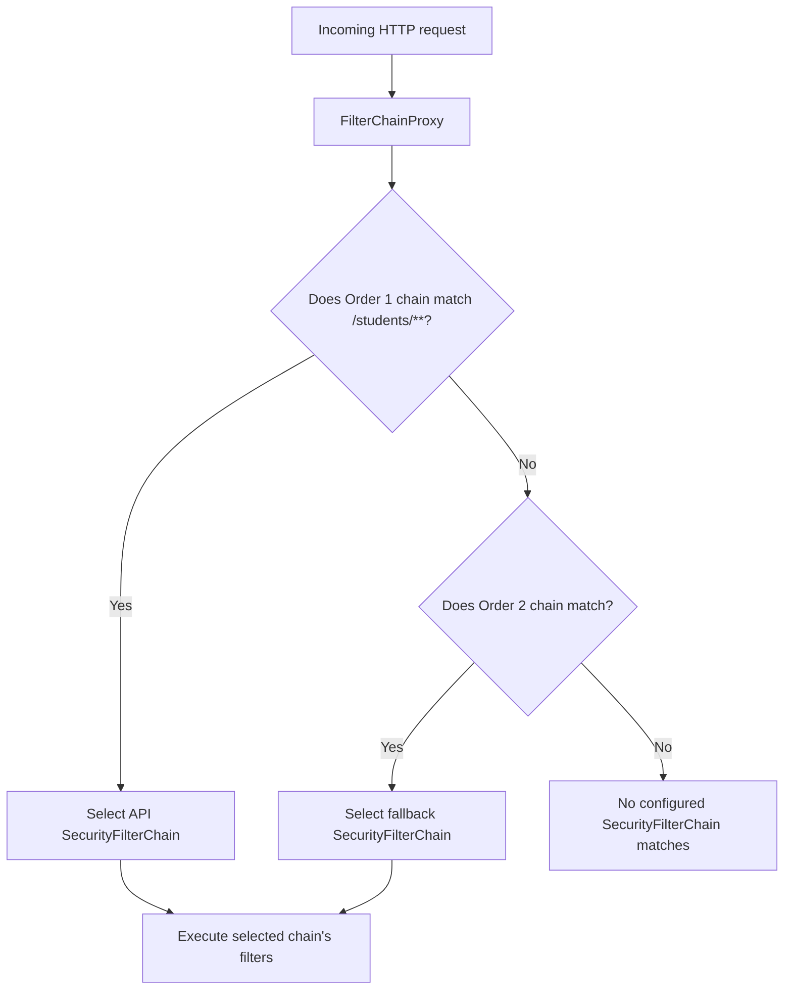

For the example above:

| Request | Selected chain | Resulting rule |
|---|---|---|
| `GET /students` | Order 1: API chain | Authentication required |
| `POST /students` | Order 1: API chain | Authentication required |
| `GET /students/1` | Order 1: API chain | Authentication required |
| `GET /products` | Order 2: fallback chain | Permitted |
| `GET /employees` | Order 2: fallback chain | Permitted |

The fallback chain is important because a request that does not match a configured chain is not automatically handled by the other chain's rules. If the application needs a default security policy, define a broad chain deliberately.

> **Security warning:** The example fallback chain uses `permitAll()`. That makes requests handled by the fallback chain publicly accessible. This is only an example to demonstrate chain selection. In a real application, choose the fallback policy intentionally.

## 10.4 Why does the first matching chain matter?

Imagine two chains both match `/students/**`:

```java
@Bean
@Order(1)
public SecurityFilterChain firstChain(HttpSecurity http)
        throws Exception {

    http
        .securityMatcher("/students/**")
        .authorizeHttpRequests(auth ->
            auth.anyRequest().permitAll()
        );

    return http.build();
}

@Bean
@Order(2)
public SecurityFilterChain secondChain(HttpSecurity http)
        throws Exception {

    http
        .securityMatcher("/students/**")
        .authorizeHttpRequests(auth ->
            auth.anyRequest().authenticated()
        )
        .httpBasic(Customizer.withDefaults());

    return http.build();
}
```

For a request to `/students`, the first chain matches. It is selected, and the second chain is not tried as an additional layer.

Therefore, the second chain's `.authenticated()` rule does not protect that request.

This is why specific chains should be ordered before broader chains, and why overlapping matchers must be considered carefully.

## 10.5 What happens if no chain matches?

If the application defines only:

```java
.securityMatcher("/students/**")
```

then a request to `/products` does not match that chain.

Spring Security does not automatically apply that chain's authorization rules to `/products`.

A broad fallback chain is commonly used when the application needs a policy for all remaining requests.

---

# 11. URL Matching: Servlet Filters vs Spring Security

One of the important questions during this feature was whether this:

```java
@WebFilter(urlPatterns = "/students/*")
public class MyCustomFilter implements Filter {
    // ...
}
```

is related to this:

```java
.authorizeHttpRequests(auth ->
    auth.anyRequest().authenticated()
)
```

They solve different problems.

| Configuration | What it controls |
|---|---|
| `@WebFilter(urlPatterns = "/students/*")` | Which requests pass through that Servlet filter |
| `securityMatcher("/students/**")` | Which requests are handled by a particular Spring Security chain |
| `requestMatchers("/students/**")` | Which requests a particular authorization rule applies to |
| `anyRequest()` | All remaining requests handled by the selected chain |

For example, `anyRequest().authenticated()` does not mean only `/students/**`. It means every request handled by the selected `SecurityFilterChain`.

If the chain has a `securityMatcher("/students/**")`, then the chain's `anyRequest()` rule applies to all requests that reached that chain — namely, requests matching its chain matcher.

## 11.1 `*` versus `**`

For the path patterns discussed in this feature:

- `*` matches within one path segment.
- `**` is the recursive wildcard used to match across multiple path segments.

| Path | `/students/*` | `/students/**` |
|---|---:|---:|
| `/students/1` | Yes | Yes |
| `/students/security-info` | Yes | Yes |
| `/students/1/details` | No | Yes |
| `/students/1/details/marks` | No | Yes |

Use the pattern that matches the intended URL structure.

### What about `/students/***`?

`***` is not a special third-level recursive wildcard. Do not use it to mean “match everything below students.”

Use the standard patterns:

```java
"/students/*"
"/students/**"
```

The precise matching behavior can depend on the matcher implementation and Spring Security version, so verify unusual edge cases against the matcher used by the application.

---

# 12. HTTP Basic, CSRF, and the Builder Pattern

These topics came up together because they all appeared in the initial `SecurityFilterChain` configuration.

## 12.1 HTTP Basic is not a CSRF token

This configuration:

```java
.httpBasic(Customizer.withDefaults())
```

enables HTTP Basic authentication.

The client sends credentials in the HTTP `Authorization` header:

```http
Authorization: Basic <base64-encoded-credentials>
```

The Base64 value represents the username and password separated by a colon. Base64 is not encryption.

CSRF protection is a separate mechanism. A CSRF token is used to help protect against forged requests that rely on credentials automatically attached by a browser, such as session cookies.

These are not interchangeable:

| Item | Purpose |
|---|---|
| Generated Spring Security password | Password for the generated default user in the initial setup |
| `Authorization: Basic ...` | Carries HTTP Basic credentials |
| CSRF token | Helps protect against certain cross-site forged requests |
| `JSESSIONID` | Identifies an HTTP session |

The generated password shown in the application startup log is not a CSRF token.

## 12.2 Why was CSRF disabled for the Postman exercises?

Spring Security enables CSRF protection by default for relevant configurations.

For state-changing requests such as POST, PUT, PATCH, and DELETE, a valid CSRF token may be required.

For example:

```http
POST /students
Content-Type: application/json
```

Even if the request contains valid HTTP Basic credentials, CSRF protection can independently reject it if a required CSRF token is missing.

Authentication and CSRF protection address different threats:

| Mechanism | Responsibility |
|---|---|
| Authentication | Establishes who is making the request |
| Authorization | Determines what the identity may access |
| CSRF protection | Helps prevent forged requests using automatically attached browser credentials |

For the learning exercises, CSRF was temporarily disabled to simplify testing POST, PUT, and DELETE requests from Postman:

```java
.csrf(csrf -> csrf.disable())
```

This is a testing convenience, not a universal production recommendation. In particular, applications using cookie-based browser authentication must assess CSRF protection carefully.

## 12.3 Where does HTTP Basic execute?

In the observed security filter chain, `BasicAuthenticationFilter` processed the Basic credentials.

It appeared before `AuthorizationFilter`:

```text
SecurityContextHolderFilter
HeaderWriterFilter
LogoutFilter
BasicAuthenticationFilter
RequestCacheAwareFilter
SecurityContextHolderAwareRequestFilter
AnonymousAuthenticationFilter
ExceptionTranslationFilter
AuthorizationFilter
```

This ordering allows authentication processing to establish an identity before the authorization decision is enforced.

## 12.4 Why does `http.build()` return a SecurityFilterChain?

`HttpSecurity` is a builder/configuration object.

The configuration methods describe the security behavior:

```java
http
    .csrf(csrf -> csrf.disable())
    .authorizeHttpRequests(auth ->
        auth.anyRequest().authenticated()
    )
    .httpBasic(Customizer.withDefaults());
```

Then:

```java
return http.build();
```

The builder creates the configured `SecurityFilterChain`.

The word “chain” describes the ordered filter execution model. It does not mean the resulting object must be a literal linked list of objects connected by `next` references.

---

# 13. Debugging Spring Security

The feature used Spring Security debug output to inspect the configured security filters and understand request processing.

The configuration included:

```properties
spring.security.debug=true
```

The learning notes also discussed the annotation-based form:

```java
@EnableWebSecurity(debug = true)
```

These are not settings that should be assumed to behave identically in every Spring Boot and Spring Security version. Use the mechanism supported by the versions and configuration in the project, and verify that debug output is actually enabled.

Debug logging is useful during development because it can reveal:

- Which security chain was selected.
- Which filters are in the chain.
- How Spring Security is processing a request.
- Request details useful for diagnosing security configuration.

Do not leave verbose security debugging enabled in production. Debug output can expose sensitive request details or security-related information in application logs, create noisy logs, and increase operational overhead. Production logging should be deliberately configured and access-controlled.

---

**End of Batch 2**
# Spring Security Architecture – Batch 3

> **Scope:** SecurityContext lifecycle and persistence, `SecurityContextHolder`, `SecurityContextRepository`, HTTP sessions, `JSESSIONID`, and the differences between HTTP Basic, session-based authentication, and JWT.
>
> **Continuation:** This is Batch 3 of the Spring Security architecture README. It is intentionally standalone so it can be pasted after Batch 2.

---

# 14. SecurityContext Lifecycle and Persistence

This topic answers one fundamental question:

**When a user successfully authenticates, how does Spring Security remember who that user is when they send another HTTP request?**

To understand this, we need to connect four components:

1. `SecurityContext`
2. `SecurityContextHolder`
3. `SecurityContextRepository`
4. HTTP Session (`HttpSession`)

## 14.1 The problem: HTTP requests are independent

HTTP is stateless by default. Each HTTP request is independent. The server does not automatically remember that two requests came from the same client.

Imagine a user accessing the Student Management API.

The first request is:

```http
POST /students
Authorization: Basic <encoded-credentials>
```

Spring Security authenticates the supplied credentials. It now has information such as:

- Username: `user`
- Authorities: for example, `ROLE_USER`
- Authentication status: authenticated

But consider a second independent request:

```http
GET /students
```

If that request contains no credentials or other authentication proof, the authentication from the previous request is not automatically available merely because the earlier request succeeded.

The server needs an authentication mechanism or a previously saved security context.

One common mechanism for preserving authentication between requests is an HTTP session.

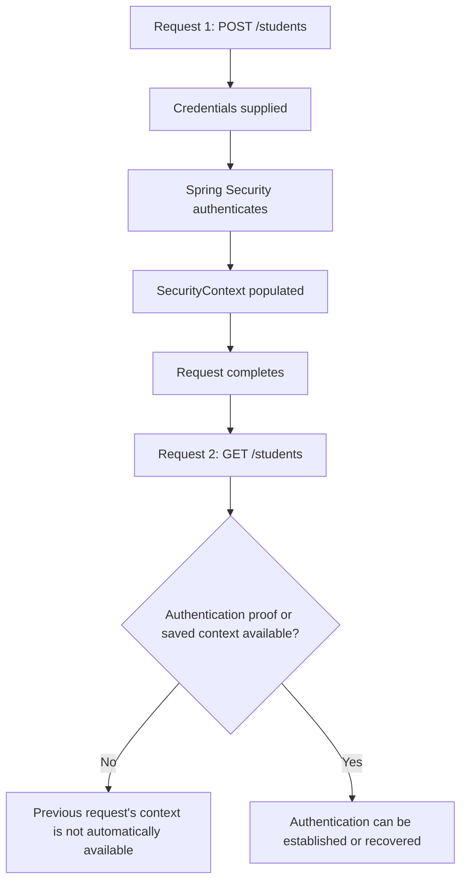

---

# 15. What Is a SecurityContext?

A `SecurityContext` is an object that holds security information associated with the current execution context.

Its most important property is:

```java
Authentication getAuthentication();
```

The `Authentication` object represents the current user's authentication information.

You can access it like this:

```java
SecurityContext context =
        SecurityContextHolder.getContext();

Authentication authentication =
        context.getAuthentication();
```

The `Authentication` object can provide information through methods such as:

| Method | Purpose |
|---|---|
| `getPrincipal()` | Identifies the user, often through a `UserDetails` object |
| `getName()` | Returns the user's name |
| `getAuthorities()` | Returns granted roles and permissions |
| `getCredentials()` | Returns credentials, if they are retained |
| `isAuthenticated()` | Indicates whether the authentication has been marked authenticated |

Example:

```java
Authentication authentication =
        SecurityContextHolder.getContext().getAuthentication();

System.out.println(authentication.getName());
System.out.println(authentication.getAuthorities());
System.out.println(authentication.isAuthenticated());
```

The password is generally not retained after successful authentication. Authentication providers and filters commonly clear sensitive credentials.

**Important distinction:** `SecurityContext` holds the `Authentication` object. It is not itself responsible for authenticating the user.

## 15.1 Relationship between SecurityContext and Authentication

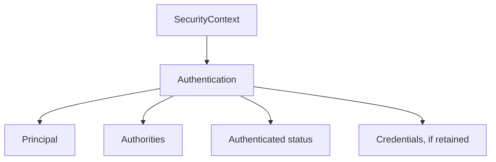

---

# 16. What Is SecurityContextHolder?

Spring Security may authenticate a request and populate its `SecurityContext`. Other filters and application components need a way to access that context.

That is the responsibility of `SecurityContextHolder`.

It provides convenient access to the current `SecurityContext`:

```java
SecurityContextHolder.getContext();
```

The default strategy used by Spring Security is:

```java
SecurityContextHolder.MODE_THREADLOCAL
```

## 16.1 What does ThreadLocal mean?

A `ThreadLocal` associates a value with a particular thread rather than storing it in one ordinary shared variable.

A server can process multiple requests concurrently using different threads.

Conceptually:

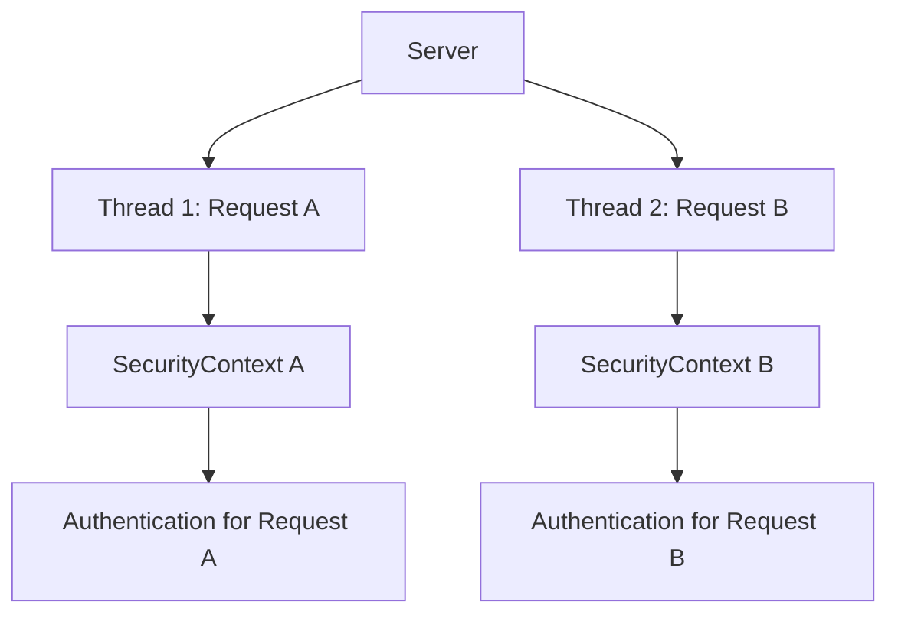

With the default thread-local strategy, each thread accesses its own context during normal thread-bound request processing. This helps prevent one request from accidentally reading another request's authentication context.

At the end of request processing, Spring Security clears the thread-bound context so that a reused server thread does not accidentally retain the previous request's identity.

### Important: ThreadLocal is not permanent storage

`ThreadLocal` is:

- Not a database.
- Not an HTTP session.
- Not permanent storage.
- A way to make the current context available during execution on a particular thread.

It does not, by itself, preserve authentication across independent HTTP requests.

---

# 17. What Is SecurityContextRepository?

This is the central component for understanding how security context information can be recovered later.

We know:

- `SecurityContext` holds authentication information.
- `SecurityContextHolder` provides access to the current context.
- The thread-bound context is cleared after request processing.

So how can Spring Security recover authentication information in a later request?

It uses a `SecurityContextRepository`.

A `SecurityContextRepository` is an abstraction responsible for loading and saving `SecurityContext` information.

The relevant operations in modern Spring Security include:

```java
loadDeferredContext(request);
saveContext(context, request, response);
```

The exact API has evolved across Spring Security versions. In modern versions, loading is generally deferred until the context is actually needed.

Conceptually:

| Operation | Meaning |
|---|---|
| Loading | Retrieve an existing `SecurityContext` |
| Saving | Store a `SecurityContext` so it can be recovered later |

Spring Security provides different repository implementations for different persistence requirements.

## 17.1 RequestAttributeSecurityContextRepository

`RequestAttributeSecurityContextRepository` stores the context as a request attribute.

A request attribute exists only during the lifetime of that request.

Conceptually:

```text
HTTP Request
    |
    +-- Request Attributes
            |
            +-- SecurityContext
                    |
                    +-- Authentication
```

This can allow the context to remain available during different dispatches of the same request, such as an error dispatch.

However, it does not provide authentication persistence across independent HTTP requests.

## 17.2 HttpSessionSecurityContextRepository

`HttpSessionSecurityContextRepository` stores the `SecurityContext` in an HTTP session.

An HTTP session is a server-side mechanism for maintaining information associated with a client across multiple requests.

Conceptually:

```text
Server
  |
  +-- HTTP Session
          |
          +-- SecurityContext
                  |
                  +-- Authentication
                          |
                          +-- Principal
                          +-- Authorities
                          +-- Authenticated status
```

When the context is saved in the session, the server has a way to recover the user's authentication information when another request arrives.

---

# 18. What Is an HTTP Session?

An HTTP session is a server-side storage area associated with a client.

Suppose a user logs in to a website:

1. The server creates or uses an HTTP session.
2. The server associates information with that session.
3. The server gives the client a session identifier.
4. The client sends that identifier with later requests.
5. The server uses the identifier to locate the corresponding session.

A common session cookie name is:

```http
Set-Cookie: JSESSIONID=ABC123XYZ
```

The browser stores the cookie.

On subsequent requests, it sends:

```http
Cookie: JSESSIONID=ABC123XYZ
```

The server uses the session identifier to find the corresponding HTTP session.

## 18.1 Session lifecycle

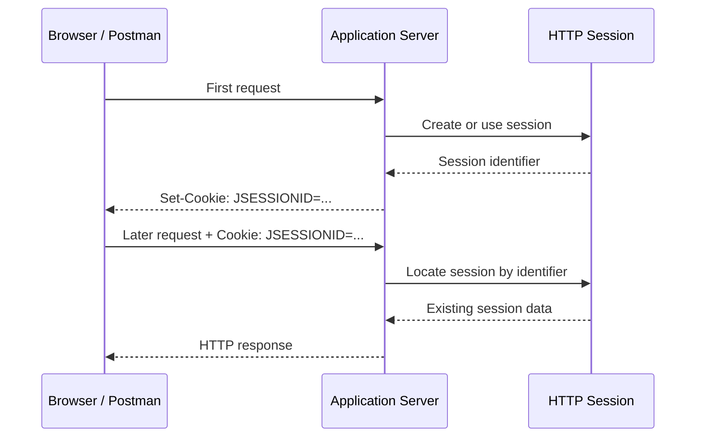

## 18.2 How does session-based authentication work?

A typical session-based authentication sequence is:

1. The user submits credentials.
2. The server validates the credentials.
3. The server creates or uses an HTTP session.
4. `HttpSessionSecurityContextRepository` can save the `SecurityContext` in that session.
5. The server sends the `JSESSIONID` cookie.
6. The client sends that cookie with a later request.
7. The server locates the session and recovers the saved `SecurityContext`.
8. Spring Security can use the recovered `Authentication` for authorization.

The client does not need to submit the username and password again on every request when the saved session context is being used.

---

# 19. Complete SecurityContext Lifecycle

Now connect authentication, context storage, context recovery, and cleanup.

## 19.1 First request – authentication and saving

1. The client submits credentials.
2. Spring Security authenticates through the `AuthenticationManager` and an `AuthenticationProvider`.
3. A successful `Authentication` object is created.
4. The `Authentication` object is placed inside a `SecurityContext`.
5. If the authentication mechanism and configuration require persistence, a suitable `SecurityContextRepository` saves the context. For session-based persistence, this can be the HTTP session.
6. Request processing completes.
7. `SecurityContextHolderFilter` clears the thread-bound context at the end of its processing.

## 19.2 Second request – context recovery

1. The client sends another request, including the `JSESSIONID` cookie.
2. The repository can locate and load the previously saved context from the session.
3. `SecurityContextHolder` makes the context available to the current request's processing thread.
4. Spring Security evaluates authorization using the recovered authentication.
5. Request processing completes.
6. The thread-bound context is cleared again.

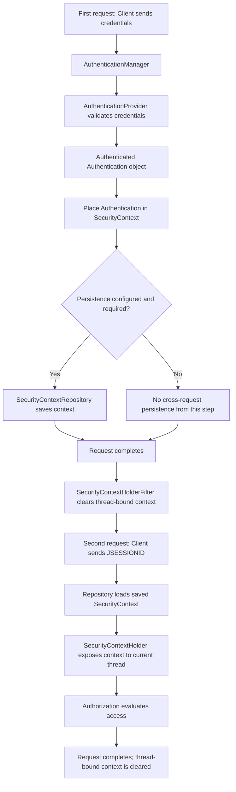

### Important modern Spring Security detail

In modern Spring Security, `SecurityContextHolderFilter` loads the context from the configured repository and clears it at the end of processing. It does **not** automatically save every changed context.

Authentication mechanisms that need persistence must explicitly save the context.

This is why the exact configuration and authentication mechanism matter. Do not assume that a context is saved merely because it exists in `SecurityContextHolder`.

---

# 20. HTTP Basic vs Session-Based Authentication

This comparison connects the SecurityContext topic to the HTTP Basic experiments performed earlier with Postman.

| Aspect | HTTP Basic | Session-based authentication |
|---|---|---|
| Credentials | Sent with each authenticated request | Normally submitted during login |
| Authentication | Generally repeated per request | Normally performed at login |
| Session required | Not inherently | Yes, for this persistence mechanism |
| Context persistence | Not inherently across requests | Can be saved in an HTTP session |
| Client identifier | `Authorization` header | Usually `JSESSIONID` cookie |
| User identity | Reconstructed from credentials | Recovered from saved context |

## 20.1 HTTP Basic example

```http
POST /students
Authorization: Basic <encoded-credentials>
```

In the normal HTTP Basic configuration used in this project, credentials are supplied and authenticated again on each independent request.

## 20.2 Session-based example

First request:

```http
POST /login
```

After successful authentication, the server can send:

```http
Set-Cookie: JSESSIONID=ABC123XYZ
```

Second request:

```http
GET /students
Cookie: JSESSIONID=ABC123XYZ
```

Spring Security can recover the previously saved authentication from the session.

### Important qualification

HTTP Basic does not inherently prohibit session persistence. However, in the normal Basic Authentication configuration used in this learning project, expect credentials to be supplied and authenticated again for each independent request.

---

# 21. What About JWT Authentication?

JWT stands for JSON Web Token. It is a common approach to token-based authentication.

A typical flow is:

1. The user submits credentials.
2. The server authenticates the user.
3. The server generates a signed JWT.
4. The client stores the token.
5. The client sends the token with subsequent requests.

For example:

```http
GET /students
Authorization: Bearer <JWT_TOKEN>
```

Spring Security validates the token and constructs an authenticated `Authentication` object for that request.

That information is then placed in a `SecurityContext`.

An important point:

**JWT does not mean Spring Security skips authentication processing on subsequent requests.**

The server still validates the token and reconstructs the authentication information. What JWT generally avoids is storing a server-side HTTP session for that authentication.

JWT will be studied in detail in the dedicated token-authentication feature.

## 21.1 Comparing the three approaches

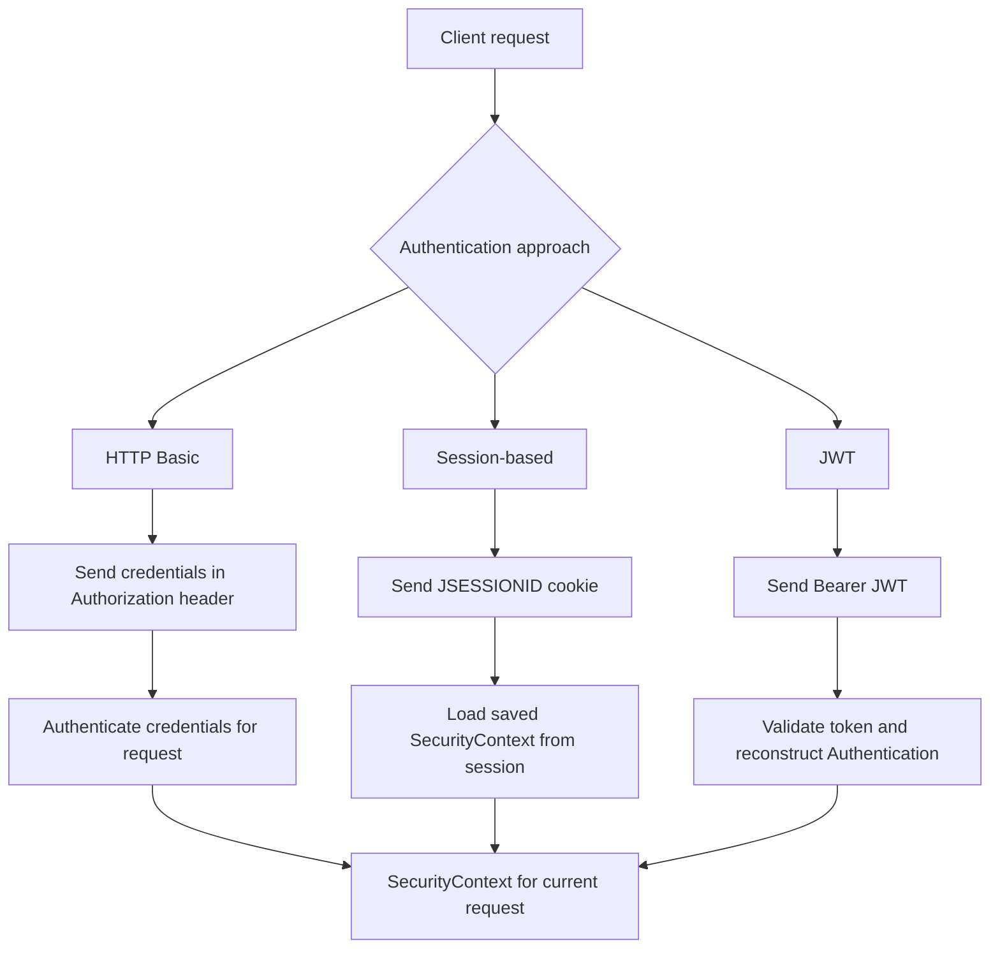

---

# 22. Practical Code: Inspect the Current SecurityContext

To make these concepts tangible, the following endpoint can temporarily be added to an existing controller.

```java
@GetMapping("/security-info")
public String getSecurityInfo() {

    Authentication authentication =
            SecurityContextHolder.getContext().getAuthentication();

    return "Username: " + authentication.getName()
            + "\nAuthorities: " + authentication.getAuthorities()
            + "\nAuthenticated: " + authentication.isAuthenticated();
}
```

Required imports:

```java
import org.springframework.security.core.Authentication;
import org.springframework.security.core.context.SecurityContextHolder;
```

With the multiple-chain configuration discussed earlier, `/security-info` does not match `/students/**`. It therefore falls under the second, `permitAll()` chain.

This makes it possible to inspect what authentication is available for a request handled by that chain.

### Anonymous authentication nuance

For a request without credentials, Spring Security may provide an anonymous authentication object.

An important detail:

`isAuthenticated()` can be `true` for an `AnonymousAuthenticationToken`, even though no real user has authenticated.

When distinguishing anonymous access from a genuinely authenticated user, inspect the authentication type or use Spring Security's anonymous-authentication checks. Do not rely on `isAuthenticated()` alone.

---

# 23. Practical Code: Inspect the Existing HTTP Session

You can also inspect whether an HTTP session already exists.

```java
@GetMapping("/session-info")
public String getSessionInfo(HttpServletRequest request) {

    HttpSession session = request.getSession(false);

    if (session == null) {
        return "No existing session";
    }

    return "Session ID: " + session.getId();
}
```

Required imports:

```java
import jakarta.servlet.http.HttpServletRequest;
import jakarta.servlet.http.HttpSession;
```

The important part is:

```java
request.getSession(false);
```

It means:

- Return the existing session if one exists.
- Do not create a new session if one does not exist.
- Return `null` if no session exists.

**Remember:** merely having an HTTP session does not prove that a `SecurityContext` was saved in it.

---

# 24. Understanding the JSESSIONID Seen in Postman

During the POST request experiment, the request log contained a cookie similar to:

```http
Cookie: JSESSIONID=<session-id>
```

This is the session identifier cookie commonly used by Tomcat.

Postman has a cookie manager. When the server sends a session cookie, Postman can store it and automatically attach it to later requests to the same host.

That explains why both GET and POST requests can contain a `JSESSIONID` cookie.

It does **not** mean that GET and POST inherently require a session. It means that Postman has a session cookie stored for that server.

## 24.1 Why can a session exist when HTTP Basic is enabled?

HTTP Basic authentication and HTTP sessions are not mutually exclusive.

HTTP Basic normally sends credentials with each request. It does not inherently require a session to remember the authenticated user.

However, other parts of an application or framework can create a session independently. For example:

- Application code might call `request.getSession()`.
- A request cache might create or use a session.
- Other framework functionality might create one.

Even if a session exists, that does not prove Spring Security stored the authenticated user's `SecurityContext` in it.

## 24.2 A practical experiment

In Postman:

1. Open the Cookies section for `localhost`.
2. Remove the `JSESSIONID` cookie.
3. Send the GET request again.
4. Inspect the response and application logs.
5. Use the `/session-info` endpoint to check whether a session exists.

This helps establish whether a session is being created by another part of the application.

> **Security note:** Do not publish real Basic Authentication headers or session cookies in a public repository. A Base64-encoded Basic header is reversible, and a valid session cookie can potentially be used to access an existing session. Replace real values with placeholders in documentation.

---

# 25. Interview Revision

| Question | Core answer |
|---|---|
| What is `SecurityContext`? | Holds the current `Authentication` object. |
| What is `SecurityContextHolder`? | Provides access to the current `SecurityContext`. |
| What is its default strategy? | `MODE_THREADLOCAL`. |
| What is `SecurityContextRepository`? | Loads and saves `SecurityContext` information. |
| What is `HttpSessionSecurityContextRepository`? | Stores and retrieves `SecurityContext` through an HTTP session. |
| What is `JSESSIONID`? | A cookie containing the session identifier. |
| Does ThreadLocal persist authentication across requests? | No. |
| Does HTTP Basic normally authenticate again per request? | Yes, in the normal configuration used here. |
| Does session authentication require credentials on every request? | No. The saved context can be recovered from the session. |
| Does JWT eliminate authentication processing? | No. The token must be validated for each request. |
| Does the existence of a session prove that SecurityContext was saved? | No. A session can exist for other reasons. |
| Does `SecurityContextHolderFilter` automatically save every changed context? | No. In modern Spring Security, mechanisms requiring persistence must explicitly save it. |

---

# 26. Final Mental Model

Remember these four statements:

1. **Authentication** represents who the user is and what authorities they possess.
2. **SecurityContext** holds that `Authentication` object.
3. **SecurityContextHolder** provides access to the context during request processing.
4. **SecurityContextRepository** handles loading and saving the context, potentially allowing authentication to survive across multiple requests.

The most important distinction is:

> **ThreadLocal manages access during execution; HttpSession can preserve authentication between requests.**

That completes the conceptual foundation of SecurityContext lifecycle and persistence.

---

**End of Batch 3**
# Spring Security Architecture – Batch 4

> **Scope:** `ExceptionTranslationFilter`, `AuthenticationEntryPoint`, `AccessDeniedHandler`, 401 vs 403, custom JSON error responses, practical Student Management API configuration, and the questions/clarifications collected in Part 6.
>
> **Continuation:** This is Batch 4 of the Spring Security architecture README. It is intentionally standalone so it can be pasted after Batch 3.

---

# 27. Exception Handling in Spring Security

So far, the feature has covered how Spring Security selects a `SecurityFilterChain`, establishes authentication, and evaluates authorization rules.

The next question is:

**What happens when authentication or authorization fails?**

The Student Management API has already produced responses such as:

- `401 Unauthorized`
- `403 Forbidden`

Now we need to understand which Spring Security components are responsible for those outcomes.

This topic brings three components together:

1. `ExceptionTranslationFilter`
2. `AuthenticationEntryPoint`
3. `AccessDeniedHandler`

By the end of this section, the distinction between an unauthenticated user and an authenticated user without sufficient permissions should be clear.

## 27.1 First, understand the problem

Imagine the API has this endpoint:

```java
@GetMapping("/students")
public List<Student> getAllStudents() {
    return studentService.getAllStudents();
}
```

And the security configuration requires authentication:

```java
.authorizeHttpRequests(auth -> auth
    .requestMatchers("/students/**").authenticated()
)
```

There are two different situations.

### Situation A – The user is not authenticated

The client sends:

```http
GET /students
```

No credentials or other authentication proof are supplied. The request has no established authenticated identity.

Expected result:

```http
HTTP/1.1 401 Unauthorized
```

### Situation B – The user is authenticated but lacks permission

Imagine the user has:

```text
ROLE_USER
```

But the endpoint requires:

```java
.requestMatchers("/students/delete/**").hasRole("ADMIN")
```

The user has authenticated successfully, but does not have the required authority.

Expected result:

```http
HTTP/1.1 403 Forbidden
```

### The distinction

| Situation | Problem | Typical HTTP result |
|---|---|---:|
| User is not authenticated | Identity has not been established | 401 |
| User is authenticated but lacks permission | Access is not authorized | 403 |

This distinction is the foundation of Spring Security's exception-handling path.

---

# 28. What Is ExceptionTranslationFilter?

`ExceptionTranslationFilter` is a Spring Security filter responsible for translating relevant security exceptions into HTTP-level responses.

In simple terms:

> It acts as a bridge between Java security exceptions and HTTP responses.

Java code and Spring Security components may raise exceptions such as:

```java
AuthenticationException
```

or:

```java
AccessDeniedException
```

A client such as Postman does not receive a Java exception as its normal HTTP response. It receives an HTTP status and, depending on the configuration, a response body.

`ExceptionTranslationFilter` helps convert relevant downstream security exceptions into outcomes such as:

- `401 Unauthorized`
- `403 Forbidden`

## 28.1 Where does it sit in the filter chain?

It generally appears before `AuthorizationFilter` in the Spring Security filter chain.

Conceptually:

```text
Authentication filters
    |
    v
BasicAuthenticationFilter, etc.
    |
    v
ExceptionTranslationFilter
    |
    | wraps downstream filter execution
    v
AuthorizationFilter
    |
    v
DispatcherServlet
```

The important point is that `ExceptionTranslationFilter` does not normally authenticate users or evaluate authorization rules itself.

Instead, it establishes an exception-handling boundary around downstream processing and translates relevant security exceptions.

## 28.2 The two important exception types

| Exception | Meaning |
|---|---|
| `AuthenticationException` | Authentication failed or could not be established |
| `AccessDeniedException` | Access to a resource was denied |

The way these exceptions are handled depends on the current authentication state and the component that raised the exception.

---

# 29. How ExceptionTranslationFilter Works

There are two important paths to understand.

## 29.1 Path A – An unauthenticated user requests a protected resource

Suppose an unauthenticated user requests:

```http
GET /students
```

The configuration requires authentication.

The conceptual flow is:

1. The request reaches the selected Spring Security filter chain.
2. `ExceptionTranslationFilter` establishes its exception-handling boundary.
3. `AuthorizationFilter` evaluates the configured authorization rule.
4. The request has no authenticated user.
5. The authorization process can raise an `AccessDeniedException`.
6. `ExceptionTranslationFilter` checks the current authentication state.
7. It recognizes that the user is anonymous or insufficiently authenticated.
8. It invokes the configured `AuthenticationEntryPoint`.
9. The client receives a 401 response.

An important subtlety:

An unauthenticated request can initially result in an `AccessDeniedException`. `ExceptionTranslationFilter` recognizes that authentication is required and invokes the authentication entry point.

## 29.2 Path B – An authenticated user lacks the required authority

Now suppose the user has:

```text
Username: asher
Authorities: ROLE_USER
```

But the endpoint requires:

```text
ROLE_ADMIN
```

The flow becomes:

1. The user is authenticated.
2. `AuthorizationFilter` checks the required authority.
3. The user does not have the required permission.
4. An `AccessDeniedException` is raised.
5. `ExceptionTranslationFilter` recognizes that the user is already authenticated.
6. It invokes the configured `AccessDeniedHandler`.
7. The client receives a 403 response.

The key distinction is whether the request has an authenticated identity that can be evaluated for access.

## 29.3 Combined exception-handling flowchart

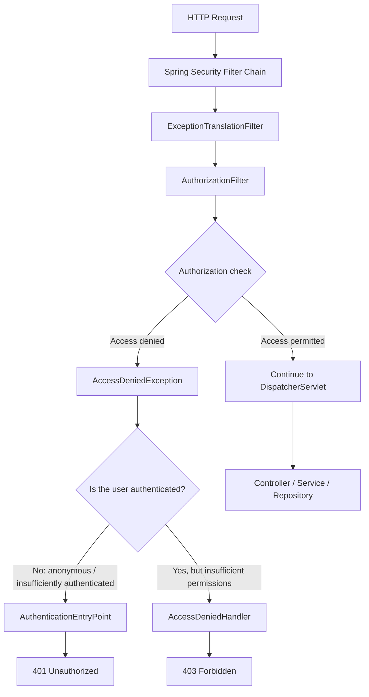

### Important qualification: invalid HTTP Basic credentials

Invalid credentials supplied through HTTP Basic are generally handled directly by `BasicAuthenticationFilter` and its authentication-failure handling.

They do not necessarily travel through `ExceptionTranslationFilter`.

Therefore, do not assume that every 401 response must pass through `ExceptionTranslationFilter` before reaching an `AuthenticationEntryPoint`.

---

# 30. What Is AuthenticationEntryPoint?

`AuthenticationEntryPoint` is a Spring Security interface that defines how authentication should be commenced when a request requires authentication.

In simpler terms:

> It defines the response or challenge used when the user needs to authenticate.

Its important method is:

```java
void commence(
    HttpServletRequest request,
    HttpServletResponse response,
    AuthenticationException authException
) throws IOException, ServletException;
```

### Method parameters

| Parameter | Meaning |
|---|---|
| `request` | The original HTTP request |
| `response` | The HTTP response being constructed |
| `authException` | The authentication-related exception |

## 30.1 What happens with HTTP Basic?

When the application configures:

```java
.httpBasic(Customizer.withDefaults())
```

Spring Security configures HTTP Basic authentication and its associated authentication entry point.

When authentication is required but the request is unauthenticated, the Basic entry point can return a response similar to:

```http
HTTP/1.1 401 Unauthorized
WWW-Authenticate: Basic realm="Realm"
```

The `WWW-Authenticate` header tells the client which authentication scheme is expected.

Postman displays the resulting status and response.

## 30.2 Implementing a custom AuthenticationEntryPoint

Suppose the application should return a JSON response when authentication is required.

A custom implementation can be created:

```java
package com.asher.Student_management.Config;

import jakarta.servlet.ServletException;
import jakarta.servlet.http.HttpServletRequest;
import jakarta.servlet.http.HttpServletResponse;

import org.springframework.security.core.AuthenticationException;
import org.springframework.security.web.AuthenticationEntryPoint;

import org.springframework.stereotype.Component;

import java.io.IOException;

@Component
public class CustomAuthenticationEntryPoint
        implements AuthenticationEntryPoint {

    @Override
    public void commence(
            HttpServletRequest request,
            HttpServletResponse response,
            AuthenticationException authException)
            throws IOException, ServletException {

        response.setStatus(HttpServletResponse.SC_UNAUTHORIZED);

        response.setContentType("application/json");

        response.getWriter().write(
            "{\"error\":\"Unauthorized\",\"message\":\"Authentication is required\"}"
        );
    }
}
```

### What does this implementation do?

1. Implements `AuthenticationEntryPoint`.
2. Overrides `commence()`.
3. Sets the HTTP status to 401.
4. Sets the response content type to JSON.
5. Writes a custom JSON response.

This allows the application to control the body returned for this authentication-required path.

---

# 31. What Is AccessDeniedHandler?

`AccessDeniedHandler` is a Spring Security interface that defines how access-denied situations are handled.

It is used when an authenticated user does not have sufficient permission to access a resource.

In simpler terms:

> It defines the response for an authenticated user who is not allowed to perform the requested operation.

Its important method is:

```java
void handle(
    HttpServletRequest request,
    HttpServletResponse response,
    AccessDeniedException accessDeniedException
) throws IOException, ServletException;
```

## 31.1 Example: ROLE_USER attempts an admin operation

Suppose the user has:

```text
ROLE_USER
```

But the endpoint requires:

```java
.hasRole("ADMIN")
```

The authorization check fails. Spring Security invokes the configured `AccessDeniedHandler` for this authenticated-but-forbidden path.

## 31.2 Implementing a custom AccessDeniedHandler

```java
package com.asher.Student_management.Config;

import jakarta.servlet.ServletException;
import jakarta.servlet.http.HttpServletRequest;
import jakarta.servlet.http.HttpServletResponse;

import org.springframework.security.access.AccessDeniedException;
import org.springframework.security.web.access.AccessDeniedHandler;

import org.springframework.stereotype.Component;

import java.io.IOException;

@Component
public class CustomAccessDeniedHandler
        implements AccessDeniedHandler {

    @Override
    public void handle(
            HttpServletRequest request,
            HttpServletResponse response,
            AccessDeniedException accessDeniedException)
            throws IOException, ServletException {

        response.setStatus(HttpServletResponse.SC_FORBIDDEN);

        response.setContentType("application/json");

        response.getWriter().write(
            "{\"error\":\"Forbidden\",\"message\":\"You do not have permission to access this resource\"}"
        );
    }
}
```

Here:

- The status is set to 403.
- The response content type is set to JSON.
- A custom JSON message is returned.

---

# 32. How the Three Components Work Together

The responsibilities are separate:

| Component | Responsibility |
|---|---|
| `ExceptionTranslationFilter` | Watches downstream security processing for relevant security exceptions and translates them |
| `AuthenticationEntryPoint` | Commences authentication, commonly returning a 401 challenge or response |
| `AccessDeniedHandler` | Handles access denial for an authenticated user, commonly returning 403 |

A useful way to remember them:

- `ExceptionTranslationFilter` = exception translator.
- `AuthenticationEntryPoint` = authentication required.
- `AccessDeniedHandler` = permission denied.

## 32.1 Who handles which responsibility?

| Component | Responsibility |
|---|---|
| `AuthenticationManager` | Coordinates authentication |
| `AuthenticationProvider` | Performs credential validation |
| `BasicAuthenticationFilter` | Processes HTTP Basic credentials |
| `AuthorizationFilter` | Checks authorization rules |
| `ExceptionTranslationFilter` | Translates relevant downstream security exceptions |
| `AuthenticationEntryPoint` | Commences authentication |
| `AccessDeniedHandler` | Handles access denial |

Do not confuse authentication with exception translation:

- `AuthenticationManager` does not decide what JSON response the client receives.
- `ExceptionTranslationFilter` does not validate passwords.
- `AuthenticationEntryPoint` does not check whether a user has `ROLE_ADMIN`.
- `AccessDeniedHandler` does not authenticate the user.

Each component has a separate responsibility.

---

# 33. Connecting Custom Handlers to the Student Management API

The earlier project configuration used a specific chain for `/students/**`.

The example below shows the authorization rules discussed in Part 6, extended with an admin-only DELETE operation.

```java
@Bean
@Order(1)
public SecurityFilterChain apiSecurityFilterChain(
        HttpSecurity http,
        CustomAuthenticationEntryPoint authenticationEntryPoint,
        CustomAccessDeniedHandler accessDeniedHandler)
        throws Exception {

    http
        .csrf(csrf -> csrf.disable())

        .securityMatcher("/students/**")

        .exceptionHandling(exception -> exception
            .authenticationEntryPoint(authenticationEntryPoint)
            .accessDeniedHandler(accessDeniedHandler)
        )

        .authorizeHttpRequests(auth -> auth

            .requestMatchers(HttpMethod.GET, "/students/**")
            .permitAll()

            .requestMatchers(HttpMethod.POST, "/students/**")
            .authenticated()

            .requestMatchers(HttpMethod.DELETE, "/students/**")
            .hasRole("ADMIN")

            .anyRequest()
            .authenticated()
        )

        .httpBasic(Customizer.withDefaults());

    return http.build();
}
```

Required imports for the configuration include:

```java
import org.springframework.context.annotation.Bean;
import org.springframework.context.annotation.Configuration;
import org.springframework.core.annotation.Order;

import org.springframework.http.HttpMethod;

import org.springframework.security.config.Customizer;
import org.springframework.security.config.annotation.web.builders.HttpSecurity;
import org.springframework.security.web.SecurityFilterChain;
```

The handler classes are Spring beans because they are annotated with `@Component`, so Spring can inject them into the configuration method.

### What do these configuration methods do?

| Configuration | Purpose |
|---|---|
| `exceptionHandling()` | Configures exception-handling behavior |
| `authenticationEntryPoint()` | Specifies how authentication is commenced |
| `accessDeniedHandler()` | Specifies how access-denied situations are handled |
| `requestMatchers()` | Defines request-specific authorization rules |
| `permitAll()` | Allows access without requiring authentication |
| `authenticated()` | Requires an authenticated user |
| `hasRole("ADMIN")` | Requires the `ROLE_ADMIN` authority |
| `anyRequest()` | Applies to remaining requests handled by this chain |

### HTTP Basic entry-point qualification

The HTTP Basic authentication mechanism has its own entry-point configuration. Spring Security integrates its Basic entry point with exception handling.

If custom entry points are configured for multiple authentication mechanisms, their interaction should be configured deliberately. In the simple API setup above, the custom entry point is intended for unauthenticated access to protected resources.

---

# 34. Authorization Examples for Three Different Users

The configuration can be understood through three hypothetical users.

| User | Authorities |
|---|---|
| User A | None – anonymous |
| User B | `ROLE_USER` |
| User C | `ROLE_ADMIN` |

The configured rules are:

| Request | Required access |
|---|---|
| `GET /students` | Everyone |
| `POST /students` | Authenticated |
| `DELETE /students/1` | `ROLE_ADMIN` |
| Other requests under `/students/**` | Authenticated |

The expected authorization outcomes are:

| Request | User A – Anonymous | User B – ROLE_USER | User C – ROLE_ADMIN |
|---|---:|---:|---:|
| `GET /students` | 200 | 200 | 200 |
| `POST /students` | 401 | Allowed | Allowed |
| `DELETE /students/1` | 401 | 403 | Allowed |

This table illustrates the practical difference between authentication-required and access-denied outcomes.

- Anonymous user attempting a protected operation: authentication is required, normally resulting in 401.
- Authenticated `ROLE_USER` attempting an admin-only operation: authenticated but forbidden, normally resulting in 403.
- Authenticated `ROLE_ADMIN` attempting the admin-only operation: authorization succeeds.

---

# 35. Practical Experiments for the Project

The following experiments were identified for the Student Management API.

| Experiment | Request | Expected result |
|---|---|---|
| 1 | POST without credentials | 401 |
| 2 | POST with invalid credentials | 401 |
| 3 | POST with valid credentials | Success |
| 4 | DELETE with `ROLE_USER` | 403 |
| 5 | DELETE with `ROLE_ADMIN` | Success |

Experiments 4 and 5 require users with different authorities. The learning discussion identified this as part of the upcoming in-memory authentication feature.

The custom handlers can be implemented and tested once a suitable protected endpoint and user authority are configured. A temporary endpoint requiring a role unavailable to the current user can help exercise the access-denied path.

---

# 36. Part 6 – Questions and Clarifications

Part 6 also collected questions raised while learning the architecture. Many revisit topics already documented in Batches 1–3. The following records the important clarifications together so the original questions and the resulting mental model remain easy to revisit.

## 36.1 What does “registered with the Servlet container” mean?

Creating a class that implements `Filter` does not automatically make Tomcat execute it.

Tomcat must know:

1. Which filter object to execute.
2. Which URL patterns it applies to.
3. Its position in the filter sequence.
4. How to invoke its lifecycle methods.

This is filter registration.

The project used Servlet filter classes such as:

```java
public class SecondCustomFilter implements Filter {
    // ...
}
```

and the Servlet API method:

```java
public void doFilter(
        ServletRequest request,
        ServletResponse response,
        FilterChain chain
) throws IOException, ServletException {
    // ...
}
```

A filter can be registered using `@WebFilter` with Servlet component scanning, or through Spring Boot's `FilterRegistrationBean`.

Example:

```java
@Bean
public FilterRegistrationBean<SecondCustomFilter> secondFilter() {

    FilterRegistrationBean<SecondCustomFilter> registration =
            new FilterRegistrationBean<>();

    registration.setFilter(new SecondCustomFilter());
    registration.addUrlPatterns("/students/*");

    return registration;
}
```

Spring Boot helps register the filter, but its execution is controlled by the Servlet container.

## 36.2 Is FilterChainProxy a class or an interface?

`FilterChainProxy` is a Spring Security class:

```java
org.springframework.security.web.FilterChainProxy
```

It implements the Servlet `Filter` interface.

It coordinates Spring Security's filter chains. It checks configured `SecurityFilterChain` instances and selects the first matching chain.

It does not simply tell every filter which filter to run next. The filters in the selected chain are executed through the chain's own filter-execution mechanism.

## 36.3 Is SecurityFilterChain itself a built-in filter?

No. `SecurityFilterChain` is an interface representing a request matcher and the Spring Security filters associated with that matcher.

Spring Security provides the built-in filter implementations. The application configures how they are assembled and when they apply.

For example:

- `BasicAuthenticationFilter` handles HTTP Basic authentication.
- `ExceptionTranslationFilter` translates relevant security exceptions.
- `AuthorizationFilter` evaluates authorization rules.
- `SecurityContextHolderFilter` manages the request's security context.

The developer generally configures these filters rather than implementing them again.

## 36.4 What is the purpose of custom filters if Spring Security already has built-in filters?

Custom filters are useful for application-specific requirements that built-in filters do not already handle in the required way.

Examples include:

- Logging request information.
- Measuring execution time.
- Validating a custom token.
- Applying application-specific request checks.
- Implementing a custom authentication mechanism.

There is no need to write a new authentication filter just to recreate functionality already provided by `BasicAuthenticationFilter`.

## 36.5 Does DelegatingFilterProxy cause all security filters to run first?

`DelegatingFilterProxy` is invoked at its registered position in the outer Servlet filter chain. It delegates to the Spring-managed `springSecurityFilterChain` bean, whose object is a `FilterChainProxy`.

The selected Spring Security chain executes. If the request is allowed to continue, processing returns to the outer Servlet filter chain.

The custom Servlet filters can then execute according to their registration order.

In the observed Student Management application, the security proxy ran before the custom filters. The logs showed:

```text
Security filter chain: [
    DisableEncodeUrlFilter
    WebAsyncManagerIntegrationFilter
    SecurityContextHolderFilter
    HeaderWriterFilter
    LogoutFilter
    BasicAuthenticationFilter
    RequestCacheAwareFilter
    SecurityContextHolderAwareRequestFilter
    AnonymousAuthenticationFilter
    ExceptionTranslationFilter
    AuthorizationFilter
]

Second Filter - Before
First Filter - Before Request received

Hibernate: select ...

First Filter - After Response completed
Second Filter - After
```

This establishes the ordering observed in this application.

**It is not a universal rule that all Servlet filters execute before `DelegatingFilterProxy`, or that the security proxy must always execute before every custom filter.** Their relative order depends on Servlet filter registration.

## 36.6 Is the Spring ApplicationContext returned after security filters execute?

No.

The `ApplicationContext` is the Spring container that manages application beans. It remains the container.

`DelegatingFilterProxy` obtains the Spring-managed filter bean from the application context and delegates request processing to it. The application context is not returned to Tomcat after security processing.

The relationship is:

```text
Tomcat
  |
  v
DelegatingFilterProxy
  |
  v
Spring ApplicationContext
  |
  v
Bean: springSecurityFilterChain
  |
  v
FilterChainProxy
  |
  v
Selected SecurityFilterChain
  |
  v
Spring Security filters
```

## 36.7 Who creates the HttpSecurity object?

Spring Security provides the `HttpSecurity` configuration object through its configuration infrastructure and supplies it to the `SecurityFilterChain` bean method.

For example:

```java
@Bean
public SecurityFilterChain securityFilterChain(
        HttpSecurity http
) throws Exception {

    http
        .authorizeHttpRequests(auth ->
            auth.anyRequest().authenticated()
        )
        .httpBasic(Customizer.withDefaults());

    return http.build();
}
```

The application does not need to create its own `HttpSecurity` bean or instantiate it manually.

The custom `SecurityFilterChain` configuration does not disable the built-in Spring Security filters. It tells Spring Security how to configure and assemble them.

## 36.8 Why disable CSRF during the Postman exercises?

With CSRF enabled, state-changing requests such as POST, PUT, PATCH, and DELETE generally require a valid CSRF token for the relevant configuration.

A request can contain valid HTTP Basic credentials and still be rejected by CSRF validation.

For the learning exercises, disabling CSRF simplifies testing these requests through Postman because a CSRF token does not have to be obtained and sent first.

```java
.csrf(csrf -> csrf.disable())
```

This is a learning convenience, not a universal production recommendation. Cookie-based browser authentication requires careful CSRF consideration.

## 36.9 Is anyRequest().authenticated() related to @WebFilter("/students/*")?

No. They control different things.

Servlet filter mapping:

```java
@WebFilter(urlPatterns = "/students/*")
public class MyCustomFilter implements Filter {
    // ...
}
```

This determines which URLs pass through that custom Servlet filter.

Spring Security authorization:

```java
.authorizeHttpRequests(auth ->
    auth.anyRequest().authenticated()
)
```

This determines the authentication requirement for all requests handled by the selected security chain.

If that chain has:

```java
.securityMatcher("/students/**")
```

then its `anyRequest()` rule applies to requests handled by that chain — the requests matching its chain matcher.

## 36.10 Does HTTP Basic use the CSRF token?

No. They are separate mechanisms.

| Item | Purpose |
|---|---|
| Generated Spring Security password | Password for the generated default user |
| Basic Authorization header | Carries HTTP Basic credentials |
| CSRF token | Helps protect against certain forged requests |
| `JSESSIONID` | Identifies an HTTP session |

The generated password shown at application startup is not a CSRF token.

HTTP Basic uses the `Authorization` header. CSRF uses a separate token, commonly sent as a request header or parameter depending on configuration.

## 36.11 Why does JSESSIONID appear in Postman requests when HTTP Basic is enabled?

HTTP Basic and HTTP sessions are not mutually exclusive.

HTTP Basic normally sends credentials with each request. It does not inherently require a session to remember the user.

However, other application or framework behavior can create a session independently. For example:

- Application code calling `request.getSession()`.
- Request-cache behavior.
- Other framework functionality.

Postman has a cookie manager. It can save a session cookie returned by the server and attach it to later requests to the same host.

The presence of `JSESSIONID` does not prove that Spring Security stored the authenticated user's `SecurityContext` in that session.

A useful experiment is to remove the cookie from Postman's cookie manager, send the request again, and inspect whether the application creates a new session.

## 36.12 What is the difference between `/students/*`, `/students/**`, and `/students/***`?

For the path-pattern discussion in this feature:

- `*` matches within one path segment.
- `**` is the recursive wildcard that can match across multiple path segments.
- `***` is not a special third-level recursive wildcard and should not be used for that purpose.

| URL | `/students/*` | `/students/**` |
|---|---:|---:|
| `/students/1` | Yes | Yes |
| `/students/security-info` | Yes | Yes |
| `/students/1/details` | No | Yes |
| `/students/1/details/marks` | No | Yes |

Use:

```java
.securityMatcher("/students/**")
```

for nested paths beneath `/students`.

Use:

```java
.securityMatcher("/students/*")
```

when the intention is to match one path segment below `/students`.

The exact behavior depends on the matcher implementation and version, but `***` should be avoided.

## 36.13 What does spring.security.debug=true do, and why avoid verbose debugging in production?

Spring Security debugging helps expose internal security processing, including:

- Which security filters are configured.
- Which security chain is selected.
- How requests are processed.
- Security-related request and response information.

Leaving verbose debugging enabled in production can:

1. Produce large volumes of logs.
2. Make genuine application problems harder to identify.
3. Expose sensitive request information in logs, depending on the debug output and configuration.
4. Increase logging overhead.

The earlier debug output included an Authorization header and a session cookie. Both are security-sensitive:

- A Basic Authorization header contains Base64-encoded credentials, which are reversible.
- A session cookie can act as a bearer credential for an existing session.

Use detailed security debugging during development and learning. Disable it before production deployment.

### Debug configuration clarification

The learning material discussed both:

```properties
spring.security.debug=true
```

and:

```java
@EnableWebSecurity(debug = true)
```

Do not assume these have identical behavior in every Spring Boot and Spring Security version. The annotation-based configuration was the explicit mechanism used in the later clarification. Verify the supported mechanism for the versions in the project.

---

# 37. Interview Revision

| Question | Core answer |
|---|---|
| What is `ExceptionTranslationFilter`? | Translates relevant downstream security exceptions into HTTP-level responses. |
| What is `AuthenticationEntryPoint`? | Defines how authentication is commenced when authentication is required. |
| What is `AccessDeniedHandler`? | Handles access denial for an authenticated user without sufficient permission. |
| What is the difference between 401 and 403? | 401 indicates authentication is required or has failed; 403 indicates access is forbidden. |
| Does `ExceptionTranslationFilter` authenticate users? | No. It translates relevant security exceptions. |
| Does `AuthenticationEntryPoint` validate passwords? | No. It handles the authentication-required response or challenge. |
| Who generally handles invalid HTTP Basic credentials? | `BasicAuthenticationFilter` handles the failure through its authentication-failure mechanism. |
| Does `AuthenticationManager` decide the JSON response? | No. It coordinates authentication. |
| Does `AuthorizationFilter` validate passwords? | No. It evaluates authorization rules. |
| Does every 401 pass through `ExceptionTranslationFilter`? | No. Invalid HTTP Basic credentials can be handled directly by `BasicAuthenticationFilter`. |
| Does every Servlet filter run before `DelegatingFilterProxy`? | No. Their order depends on Servlet filter registration. |
| Does an existing `JSESSIONID` prove the SecurityContext is stored in the session? | No. A session can exist for other reasons. |

---

# 38. Final Mental Model

The three exception-handling components can be remembered as follows:

**`ExceptionTranslationFilter`**

Watches downstream security processing for relevant security exceptions and translates them.

**`AuthenticationEntryPoint` – 401**

The request needs authentication. Commence authentication or return the appropriate challenge/error response.

**`AccessDeniedHandler` – 403**

The user is authenticated but does not have sufficient permission. Handle the access-denied response.

The complete distinction:

- `AuthenticationManager` coordinates authentication.
- `AuthenticationProvider` validates credentials.
- `BasicAuthenticationFilter` processes HTTP Basic credentials.
- `AuthorizationFilter` evaluates authorization rules.
- `ExceptionTranslationFilter` translates relevant downstream security exceptions.
- `AuthenticationEntryPoint` handles the authentication-required path.
- `AccessDeniedHandler` handles the authenticated-but-forbidden path.

---

**End of Batch 4**
