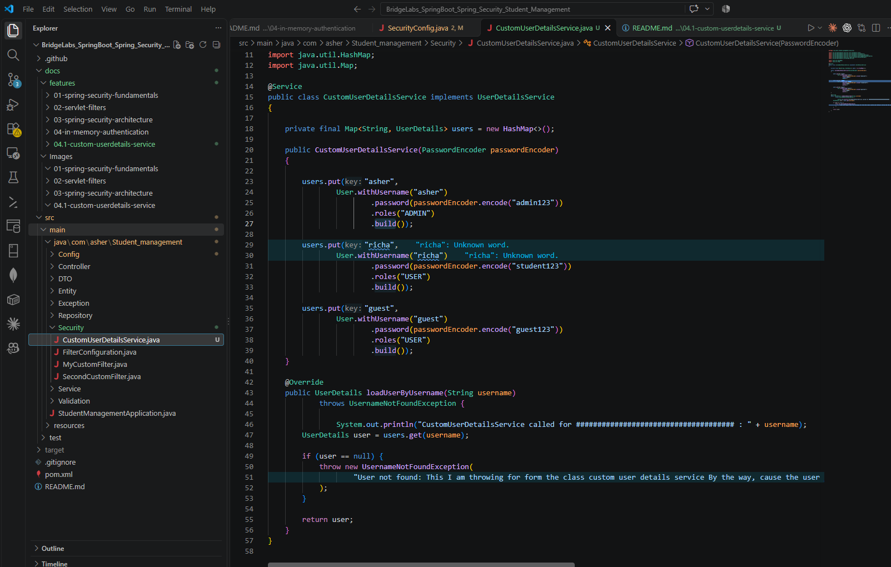
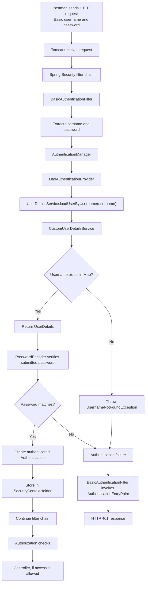
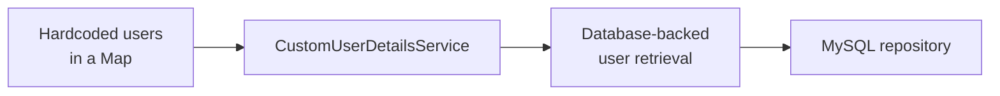

# Feature 04.1 --- Custom UserDetailsService

> **Project:** Student Management System\
> **Feature directory:**
> `docs/features/04.1-custom-userdetails-service/`\
> **Focus:** Custom user retrieval, `UserDetailsService`,
> `DaoAuthenticationProvider`, HTTP Basic authentication, and
> authentication-failure handling.

## 1. What are we learning?

In Feature 04, we used Spring Security's built-in implementation:

``` java
return new InMemoryUserDetailsManager(admin, student, guest);
```

That manager already knew how to store users and retrieve them by
username.

In Feature 04.1, we implement `UserDetailsService` ourselves. The users
are still hardcoded initially, but **we control how users are located
and returned**.

This is about customizing the authentication infrastructure before
connecting it to a database. MySQL integration is not part of this
feature.
## 1. ScreenShots OF Changes



So once you send these usernames and password from the postman the spring already has the objects of userDetailsService class and as such it can just, retrieve these object by the userDetails service class verify the password using the password encryptor and using the match function, and all this is actually performed by DaoAuthenticationFilter that Will bring together UserDetailsService and PasswordEncryptor

Honestly the rest of the things are the same, it just that now that we have a custom Representation and Function that will Implement the userDetailsService the spring wont generate that password it used to give us in the console to verify. So it already has the objects and a means to verify them.
## 2. Feature 04 versus Feature 04.1

  -----------------------------------------------------------------------
  Feature 04                          Feature 04.1
  ----------------------------------- -----------------------------------
  Used `InMemoryUserDetailsManager`   Implement our own
                                      `UserDetailsService`

  Spring provided user retrieval      We write the retrieval logic

  Configured users in the manager     Customize how users are located and
                                      returned

  Used predefined `UserDetails`       Build and return `UserDetails`
  objects                             ourselves
  -----------------------------------------------------------------------

The storage is still in memory. The important change is who implements
the retrieval logic.

## 3. Feature roadmap

1.  Understand the `UserDetailsService` contract.
2.  Implement `CustomUserDetailsService`.
3.  Implement `loadUserByUsername()`.
4.  Handle `UsernameNotFoundException`.
5.  Connect the custom service to Spring Security.
6.  Understand how `AuthenticationManager` and
    `DaoAuthenticationProvider` use it.
7.  Replace temporary `{noop}` passwords with BCrypt.
8.  Verify the service through Postman.
9.  Document and merge the feature using the repository's Git workflow.

## 4. Create the feature branch

Start from the latest `develop` branch:

``` powershell
git switch develop
git pull origin develop

git switch -c feature/custom-userdetails-service

git branch --show-current
git status
```

Expected branch:

``` text
feature/custom-userdetails-service
```

Inspect the existing project structure before creating files:

``` powershell
tree /F src/main/java
```

The project already has a dedicated `Security` package. Keep this class
there rather than creating a duplicate service elsewhere.

## 5. Understand `UserDetailsService`

`UserDetailsService` is an interface provided by Spring Security. Its
contract is small:

``` java
public interface UserDetailsService {

    UserDetails loadUserByUsername(String username)
            throws UsernameNotFoundException;
}
```

Spring Security calls `loadUserByUsername()` when it needs to retrieve a
user's details during username/password authentication.

The method must: - Find the user using the supplied username. - Return
the user's `UserDetails`. - Throw `UsernameNotFoundException` if the
user does not exist.

**Important:** `UserDetailsService` does not authenticate the submitted
password. It retrieves user information. The authentication provider
uses the returned `UserDetails` to verify the credentials.

> **Key point:** Spring Security itself calls `UserDetailsService` to
> retrieve the user when a username and password are submitted. We do
> not need to call `loadUserByUsername()` manually from our controller.
> In this username/password flow, `DaoAuthenticationProvider` calls it
> for us.

## 6. Implement `CustomUserDetailsService`

Create the class in the existing `Security` package:

``` powershell
New-Item -ItemType File -Path "src/main/java/com/asher/Student_management/Security/CustomUserDetailsService.java"
```

Initial implementation:

``` java
package com.asher.Student_management.Security;

import org.springframework.security.core.userdetails.User;
import org.springframework.security.core.userdetails.UserDetails;
import org.springframework.security.core.userdetails.UserDetailsService;
import org.springframework.security.core.userdetails.UsernameNotFoundException;
import org.springframework.stereotype.Service;

import java.util.HashMap;
import java.util.Map;

@Service
public class CustomUserDetailsService implements UserDetailsService {

    private final Map<String, UserDetails> users = new HashMap<>();

    public CustomUserDetailsService() {

        users.put("asher",
                User.withUsername("asher")
                        .password("{noop}admin123")
                        .roles("ADMIN")
                        .build());

        users.put("richa",
                User.withUsername("richa")
                        .password("{noop}student123")
                        .roles("USER")
                        .build());

        users.put("guest",
                User.withUsername("guest")
                        .password("{noop}guest123")
                        .roles("USER")
                        .build());
    }

    @Override
    public UserDetails loadUserByUsername(String username)
            throws UsernameNotFoundException {

        System.out.println(
                "CustomUserDetailsService called for: " + username
        );

        UserDetails user = users.get(username);

        if (user == null) {
            throw new UsernameNotFoundException(
                    "User not found: " + username
            );
        }

        return user;
    }
}
```

### 6.1 Understand the implementation

  -----------------------------------------------------------------------
  Code                                Responsibility
  ----------------------------------- -----------------------------------
  `@Service`                          Registers the class as a
                                      Spring-managed bean through
                                      component scanning.

  `implements UserDetailsService`     Implements Spring Security's
                                      user-retrieval contract.

  `Map<String, UserDetails>`          Stores users temporarily, using
                                      usernames as keys.

  Constructor                         Creates the demonstration users
                                      when Spring creates the service
                                      bean.

  `loadUserByUsername()`              Looks up and returns the requested
                                      user.

  `UsernameNotFoundException`         Indicates that the requested
                                      username does not exist.
  -----------------------------------------------------------------------

The lookup is the heart of our implementation:

``` java
UserDetails user = users.get(username);

if (user == null) {
    throw new UsernameNotFoundException(
            "User not found: " + username
    );
}

return user;
```

`users.get(username)` searches the map. If there is no matching key, it
returns `null`. We throw the expected exception when no user exists;
otherwise, we return the `UserDetails`.

### 6.2 Why are we using `{noop}`?

The initial code contains:

``` java
.password("{noop}admin123")
```

`{noop}` is a Spring Security password-encoding identifier. It tells the
delegating password encoder to treat the password as unencoded text for
this temporary experiment.

It is deliberately temporary and must not be used in production. In the
next implementation step, replace it with BCrypt using the existing
`PasswordEncoder` bean.

## 7. Connect the custom service to Spring Security

Previously, `SecurityConfig` declared a `UserDetailsService` bean that
returned an `InMemoryUserDetailsManager`. We are replacing that
implementation.

### 7.1 Remove the old bean

Remove the method that returned:

``` java
new InMemoryUserDetailsManager(admin, student, guest);
```

Remove imports that are no longer used in `SecurityConfig`:

``` java
import org.springframework.security.provisioning.InMemoryUserDetailsManager;
import org.springframework.security.core.userdetails.User;
import org.springframework.security.core.userdetails.UserDetails;
import org.springframework.security.core.userdetails.UserDetailsService;
```

Only remove imports that are genuinely unused in that file.

### 7.2 Keep the PasswordEncoder bean

Do not remove the existing BCrypt bean:

``` java
@Bean
public PasswordEncoder passwordEncoder() {
    return new BCryptPasswordEncoder();
}
```

We will use it when replacing the temporary `{noop}` values with
BCrypt-encoded passwords.

### 7.3 Why don't we declare another `UserDetailsService` bean?

The custom class is annotated with:

``` java
@Service
public class CustomUserDetailsService
        implements UserDetailsService {
```

`@Service` registers it as a Spring-managed component through component
scanning. We therefore do not need a second `@Bean` method returning
another `UserDetailsService` implementation.

At this point, the custom service still contains hardcoded users. We
have changed the retrieval implementation, not the storage mechanism.

## 8. How Spring Security uses our custom service

When a request arrives with HTTP Basic credentials:

1.  `BasicAuthenticationFilter` extracts the username and password from
    the Authorization header.
2.  It submits an authentication request to the `AuthenticationManager`.
3.  The manager delegates to an appropriate `AuthenticationProvider`.
4.  In this username/password setup, `DaoAuthenticationProvider`
    performs the authentication.
5.  `DaoAuthenticationProvider` calls
    `UserDetailsService.loadUserByUsername(username)`.
6.  Our `CustomUserDetailsService` searches the map and returns
    `UserDetails`.
7.  The provider checks the submitted password against the stored
    password using its configured `PasswordEncoder`.
8.  On success, an authenticated `Authentication` is returned and stored
    in the `SecurityContext`.
9.  The request continues through the remaining security filters and, if
    authorized, reaches the controller.

### 8.1 Complete authentication flow



This is a conceptual flow. Spring Security manages the actual filter
order and exception handling.

### 8.2 Responsibility of each component

  -----------------------------------------------------------------------
  Component                           Responsibility
  ----------------------------------- -----------------------------------
  `BasicAuthenticationFilter`         Extracts HTTP Basic credentials and
                                      initiates authentication.

  `AuthenticationManager`             Coordinates authentication by
                                      delegating to a provider.

  `DaoAuthenticationProvider`         Loads user details and verifies the
                                      submitted password.

  `UserDetailsService`                Defines how user details are
                                      retrieved by username.

  `CustomUserDetailsService`          Our implementation that searches
                                      the in-memory map.

  `UserDetails`                       Carries the retrieved username,
                                      password representation, and
                                      authorities.

  `PasswordEncoder`                   Checks the submitted raw password
                                      against the stored password
                                      representation.

  `SecurityContextHolder`             Holds the current security context.

  `AuthenticationEntryPoint`          Starts an authentication challenge
                                      for an unauthenticated request or
                                      handles the relevant
                                      authentication-failure path.
  -----------------------------------------------------------------------

Keep this distinction clear: **the custom service retrieves the user;
the provider verifies the password; the Basic authentication filter
handles the HTTP Basic mechanism.**

## 9. Understanding the exception and custom 401 response

During testing, an unknown username or incorrect password can produce
the same HTTP 401 response.

For example, the custom entry point may return:

``` text
HTTP Status 401 OHH my god this is the basic one haha-
Bad credentials
```

This does not mean `CustomUserDetailsService` was skipped.

### 9.1 What happens for an unknown username?

Suppose Postman sends:

``` text
Username: hello
Password: 1234
```

The flow is:

1.  `BasicAuthenticationFilter` extracts `hello` and `1234`.
2.  The authentication request reaches `AuthenticationManager`.
3.  `DaoAuthenticationProvider` calls `loadUserByUsername("hello")`.
4.  `CustomUserDetailsService` cannot find `hello`.
5.  The service throws `UsernameNotFoundException`.
6.  By default, `DaoAuthenticationProvider` hides this distinction by
    converting the user-not-found condition into a
    `BadCredentialsException`.
7.  Authentication fails.
8.  `BasicAuthenticationFilter` invokes the configured entry point for
    this authentication failure.
9.  `CustomBasicAuthenticationEntryPoint` writes the HTTP 401 response.

### 9.2 Why does Spring hide the original exception?

By default, `DaoAuthenticationProvider` has `hideUserNotFoundExceptions`
enabled. This helps avoid revealing whether a particular username
exists.

Therefore, an unknown username and an incorrect password are normally
presented to the client as a generic bad-credentials failure.

The original `UsernameNotFoundException` can occur internally without
being exposed in the HTTP response.

### 9.3 Why does Postman show our custom message?

Your `CustomBasicAuthenticationEntryPoint` is responsible for the HTTP
response body and status when it is invoked. Its response does not tell
us which internal exception originally occurred; it is the HTTP-level
handler for the failure path.

## 10. Verify that our custom service is being called

The temporary log statement in `loadUserByUsername()` helps verify the
execution path:

``` java
System.out.println(
        "CustomUserDetailsService called for: " + username
);
```

Send these requests through Postman:

  ----------------------------------------------------------------------------------------------
  Username                Password                Expected console output
  ----------------------- ----------------------- ----------------------------------------------
  `hello`                 `1234`                  `CustomUserDetailsService called for: hello`

  `asher`                 `wrongpassword`         `CustomUserDetailsService called for: asher`
  ----------------------------------------------------------------------------------------------

Both requests should fail authentication and normally return HTTP 401,
but both should invoke the custom service. Spring Security needs to
retrieve the user by username before it can verify the submitted
password.

For successful authentication, try:

  Username   Password
  ---------- --------------
  `asher`    `admin123`
  `richa`    `student123`
  `guest`    `guest123`

The request reaches the controller only if authentication succeeds and
authorization rules permit it.

> `System.out.println()` is a temporary learning aid. In a real
> application, use a logger and never log passwords or other sensitive
> credentials.

## 11. Questions and confusions addressed

### Q1. Does Spring Security call `UserDetailsService` itself?

**Yes.** In this username/password flow, `DaoAuthenticationProvider`
calls `loadUserByUsername()` when credentials are submitted. We do not
need to call the method from our controller.

### Q2. Are we authenticating the user inside `CustomUserDetailsService`?

No. The service retrieves and returns the user's details.
`DaoAuthenticationProvider` checks the submitted password using the
configured `PasswordEncoder`.

### Q3. Why implement the interface if the users are still hardcoded?

The learning objective is to customize the retrieval process. Today the
implementation searches a `Map`; later the same method can retrieve a
user from a database repository.

### Q4. Why throw `UsernameNotFoundException`?

It tells Spring Security that the requested username could not be found.
The authentication provider handles this as part of the authentication
process.

### Q5. Why does Postman show `Bad credentials` instead of `User not found`?

By default, `DaoAuthenticationProvider` hides user-not-found details and
reports a generic bad-credentials failure. The custom entry point then
formats the HTTP 401 response.

### Q6. Does `BasicAuthenticationFilter` directly search the Map?

No. It extracts HTTP Basic credentials and delegates authentication. The
provider calls `UserDetailsService`, and our service searches the map.

### Q7. Is `CustomBasicAuthenticationEntryPoint` responsible for finding the user?

No. It writes the HTTP authentication-failure response. It does not
retrieve users or compare passwords.

### Q8. Are we using MySQL now?

No. The users are still stored in a `HashMap`. Database integration is a
separate feature.

### Q9. Why remove the old `InMemoryUserDetailsManager` bean?

We are replacing that retrieval implementation with our own `@Service`
implementation. Keeping multiple competing `UserDetailsService` beans
can make configuration ambiguous unless they are explicitly qualified
and wired.

### Q10. Why keep the BCrypt `PasswordEncoder` bean if the initial custom users use `{noop}`?

The `{noop}` values are temporary for the first retrieval experiment.
The existing BCrypt bean will be used when we replace those values with
encoded passwords.

## 12. Feature completion checklist

-   [ ] Create `feature/custom-userdetails-service` from the latest
    `develop`.
-   [ ] Inspect the existing Java package structure.
-   [ ] Create `CustomUserDetailsService` in the `Security` package.
-   [ ] Implement `UserDetailsService`.
-   [ ] Add the three demonstration users to the map.
-   [ ] Implement `loadUserByUsername()`.
-   [ ] Throw `UsernameNotFoundException` when a user is missing.
-   [ ] Remove the old `InMemoryUserDetailsManager` bean from
    `SecurityConfig`.
-   [ ] Keep the existing `PasswordEncoder` bean.
-   [ ] Confirm Spring discovers the `@Service` bean.
-   [ ] Verify through Postman that the service is called for a known
    username.
-   [ ] Verify through Postman that the service is called for an unknown
    username.
-   [ ] Understand why both invalid cases normally return 401.
-   [ ] Replace `{noop}` with BCrypt in the next implementation step.
-   [ ] Review and commit the feature using the repository's Git
    workflow.

## 13. Git workflow

After implementation and testing, review the changes:

``` powershell
git status
git diff
```

Stage and commit:

``` powershell
git add .
git commit -m "Implement custom UserDetailsService"
```

Follow the branch and merge conventions already established in the
repository when merging into `develop`.

Do not commit real credentials or secrets.

## 14. What comes next?

The next step is to update `CustomUserDetailsService` to use the
existing BCrypt `PasswordEncoder` rather than temporary `{noop}` values.

After that, verify the complete authentication flow again and continue
understanding how `DaoAuthenticationProvider` uses our custom service.

The longer-term progression is:



**The key concept to retain:** Spring Security calls our
`UserDetailsService` through the authentication provider to retrieve
user details when a username and password are submitted. Our service
retrieves the user; it does not itself authenticate the password.


