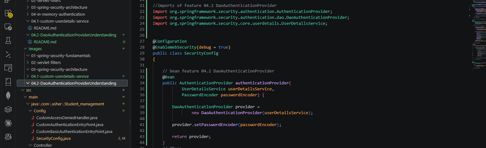
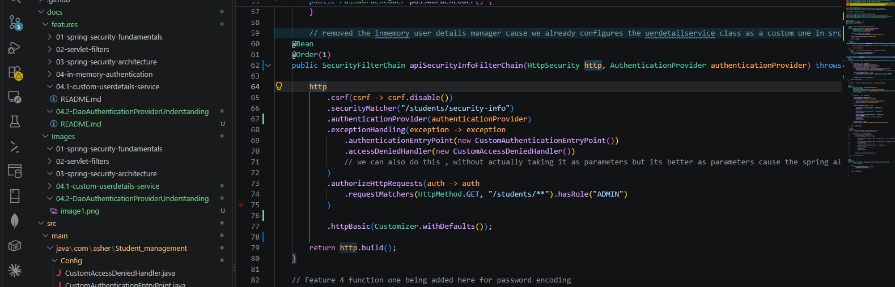
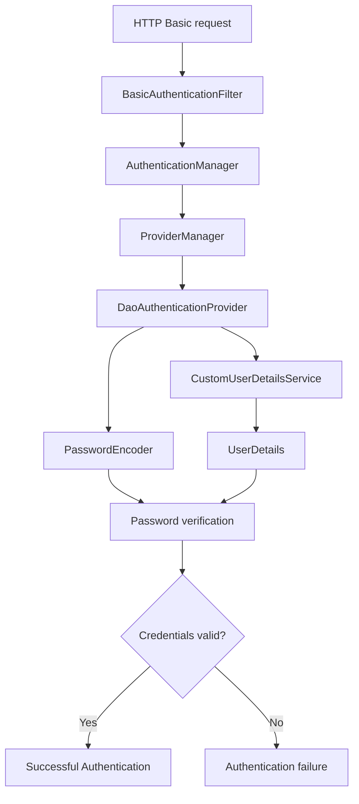
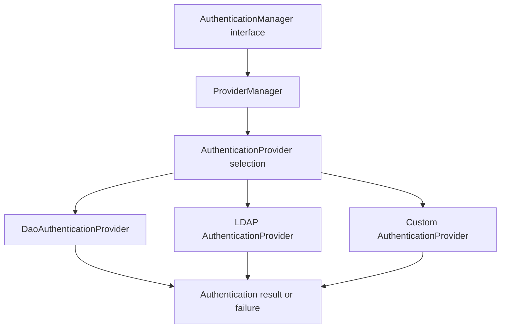
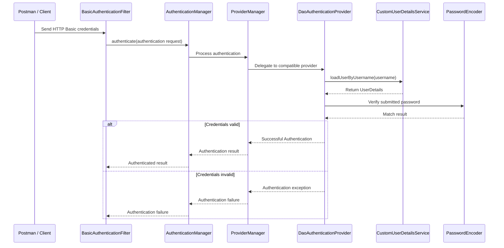

## Screenshot Explinations
Youtube Link to Understand - https://youtu.be/YwkYOUHTF2M


Spring Security can configure this provider automatically when it discovers a UserDetailsService and PasswordEncoder.

However, for learning purposes, I want us to configure it explicitly so we understand the relationship between these components.

Open your SecurityConfig.java.



Notice we have to put that authentication object in the parameter so that spring is able to inject it. It is very important 

# Feature 04.2 — AuthenticationManager and ProviderManager

**Project:** Student Management System  
**Feature directory:** `docs/features/04.2-authentication-manager-provider-manager/`  
**Focus:** Understanding how Spring Security receives authentication requests, delegates them to authentication providers, and returns an authentication result.

---

## 1. Overview

In Feature 04.1, we implemented a custom `UserDetailsService` and explicitly configured a `DaoAuthenticationProvider`.

This feature moves one level higher in the authentication architecture. We study:

- `AuthenticationManager` — the interface that defines the authentication operation.
- `ProviderManager` — a commonly used implementation of `AuthenticationManager`.
- `AuthenticationProvider` — the contract implemented by providers such as `DaoAuthenticationProvider`.
- How these components fit into our existing HTTP Basic authentication flow.

The goal is to understand how Spring Security delegates authentication work. We do not need to write our own `AuthenticationManager` for the current HTTP Basic flow.

## 2. Where this fits in our existing application

Our current HTTP Basic authentication flow can be represented as:



The diagram is a conceptual overview of the username/password authentication path. `AuthenticationManager` is the abstraction used by the filter; `ProviderManager` is the implementation that delegates to compatible providers.

## 3. What is AuthenticationManager?

`AuthenticationManager` is an interface in Spring Security responsible for processing authentication requests.

Its central method is:

```java
public interface AuthenticationManager {

    Authentication authenticate(Authentication authentication)
            throws AuthenticationException;
}
```

The method accepts an `Authentication` object and returns an `Authentication` object.

| Part | Meaning |
|---|---|
| Input | An authentication request, usually containing submitted credentials |
| Successful output | An authenticated `Authentication` containing the user's identity and authorities |
| Failure | An authentication-related exception is thrown |

The interface defines the contract. It does not prescribe how the authentication must be performed; implementations decide how to process the request.

## 4. What is ProviderManager?

`ProviderManager` is a commonly used implementation of `AuthenticationManager`.

Its responsibility is to delegate authentication requests to one or more `AuthenticationProvider` implementations.



Each provider supports particular kinds of authentication requests.

Examples:

- `DaoAuthenticationProvider` authenticates username/password credentials using a `UserDetailsService` and `PasswordEncoder`.
- An LDAP provider can authenticate against an LDAP directory.
- A custom provider can implement application-specific authentication logic.

`ProviderManager` checks whether a provider supports the incoming authentication type and delegates to a suitable provider.

**Important:** It is not guaranteed to try every provider after every failure. Whether another provider is tried depends on the exception and the manager's configuration. Provider ordering and parent-manager behaviour can also matter.

## 5. AuthenticationManager versus ProviderManager

| `AuthenticationManager` | `ProviderManager` |
|---|---|
| An interface | A concrete implementation |
| Defines the `authenticate()` contract | Implements the contract by delegating to providers |
| Describes what an authentication manager does | Provides one way to perform that work |

The relationship is:

```text
AuthenticationManager (interface)
             ^
             |
     implements
             |
     ProviderManager (class)
```

In Java terms, `ProviderManager` implements `AuthenticationManager`.

## 6. Connecting it to our Student Management application

The relevant components in our current configuration are:

| Component | Role in the flow |
|---|---|
| `BasicAuthenticationFilter` | Extracts HTTP Basic credentials and initiates authentication |
| `AuthenticationManager` | Authentication contract used by the filter |
| `ProviderManager` | Delegates the request to a compatible provider |
| `DaoAuthenticationProvider` | Performs DAO-based username/password authentication |
| `CustomUserDetailsService` | Retrieves the user's `UserDetails` |
| `PasswordEncoder` | Verifies the submitted password against the stored password representation |

The `DaoAuthenticationProvider` uses the custom service and password encoder configured in Feature 04.1. `ProviderManager` sits above the provider and coordinates the delegation.

## 7. Do we need to create AuthenticationManager ourselves?

Not for the HTTP Basic flow we have built so far.

Spring Security configures the authentication infrastructure and the security filters use it when processing HTTP Basic credentials. Our application supplies the relevant authentication components, including:

- `UserDetailsService`
- `PasswordEncoder`
- `AuthenticationProvider`

There are other situations where application code needs to obtain and use an `AuthenticationManager` directly. For example, a custom login endpoint may authenticate submitted credentials through an `AuthenticationManager` before issuing a JWT.

We will revisit that when implementing JWT authentication. The current feature is about understanding the existing HTTP Basic flow, not implementing a JWT login endpoint.

## 8. Authentication sequence



This sequence is a simplified conceptual representation. Spring Security performs additional internal processing, including authenticated-token creation and security-context handling.

## 9. Understanding check

### Question 1

Which component is responsible for retrieving user information?

- `AuthenticationManager`
- `UserDetailsService`
- `BasicAuthenticationFilter`

**Correct answer:** `UserDetailsService`

It retrieves the user's details by username. It does not verify the submitted password.

### Question 2

Which component delegates authentication requests to `AuthenticationProvider` implementations?

- `ProviderManager`
- `PasswordEncoder`
- `UserDetails`

**Correct answer:** `ProviderManager`

It is a commonly used implementation of `AuthenticationManager` and delegates requests to compatible providers.

### Question 3

What is the relationship between `AuthenticationManager` and `ProviderManager`?

- They are unrelated.
- `ProviderManager` implements `AuthenticationManager`.
- `AuthenticationManager` implements `ProviderManager`.

**Correct answer:** `ProviderManager` implements `AuthenticationManager`.

## 10. Key takeaways

- `AuthenticationManager` is an interface that defines the authentication operation.
- `ProviderManager` is a commonly used implementation of that interface.
- `ProviderManager` delegates authentication requests to compatible `AuthenticationProvider` implementations.
- `DaoAuthenticationProvider` is the provider used for our username/password authentication.
- `DaoAuthenticationProvider` retrieves user details through `CustomUserDetailsService` and verifies passwords through `PasswordEncoder`.
- We do not need to create an `AuthenticationManager` ourselves for the current HTTP Basic flow.
- A custom login flow, such as one that issues JWTs, may need to obtain and use an `AuthenticationManager` explicitly.

## 11. Screenshots of changes

This feature is primarily about understanding the authentication architecture. Add screenshots only when they demonstrate an actual implementation or verification in the project.

Store relevant screenshots in the central images directory:

```text
docs/
├── features/
│   └── 04.2-authentication-manager-provider-manager/
│       └── README.md
└── Images/
    └── 04.2-authentication-manager-provider-manager/
        ├── AuthenticationManagerConfiguration.png
        └── ProviderAuthenticationFlow.png
```

If you capture a screenshot of a file or result, reference it relative to this README:

```markdown

```

Do not add placeholder image references for screenshots that have not been captured. Ensure screenshots do not expose passwords, tokens, secrets, or database credentials.

## 12. Completion checklist

- [ ] Understand the `AuthenticationManager` interface.
- [ ] Understand the role of `ProviderManager`.
- [ ] Understand how `ProviderManager` delegates to compatible providers.
- [ ] Understand how `DaoAuthenticationProvider` fits into the current application.
- [ ] Understand why a custom `AuthenticationManager` is not required for the current HTTP Basic flow.
- [ ] Review the authentication flow diagram.
- [ ] Add relevant screenshots, if any, to `docs/Images/04.2-authentication-manager-provider-manager/`.

## 13. Git workflow

Suggested feature branch:

```text
feature/authentication-manager-provider-manager
```

Check the current branch and working tree:

```powershell
git branch --show-current
git status
```

Stage the new documentation and any screenshots:

```powershell
git add docs/features/04.2-authentication-manager-provider-manager/
git add docs/Images/04.2-authentication-manager-provider-manager/
```

Commit when the feature documentation is ready:

```powershell
git commit -m "docs: document authentication manager and provider manager"
```

---

**End of Feature 04.2 documentation.**
